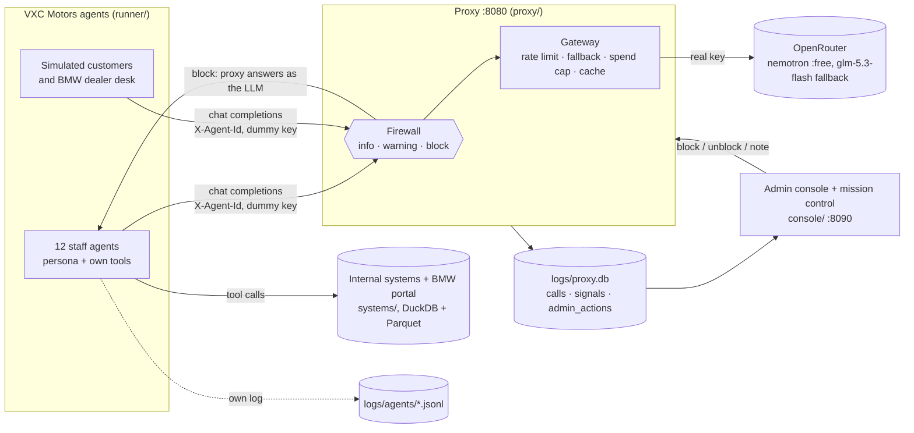

# agent-session-inspector · VXC Motors

A learning project that starts with one agent calling an LLM and ends with a simulated BMW dealership,
**VXC Motors**, whose 12 AI employees talk to the LLM through a proxy that logs, inspects and, when it
has to, blocks their conversations, while an administrator watches from a console.

- **Guided demo tour** (every lesson in order, with presenter mode): [`viz/tour/index.html`](viz/tour/index.html) · [published](https://claude.ai/artifact/AKkhWxqA8QobuxJQWRppCu)
- **Agent session explainer** (one real session, animated step by step, works offline): [`docs/explainer/index.html`](docs/explainer/index.html)
- **Master plan** (lesson table, decisions, all visualizations): [`docs/MASTER_PLAN.md`](docs/MASTER_PLAN.md)
- **Lessons**: one page each in [`docs/lessons/`](docs/lessons/), with summary, explanation, learnings, flowchart, visualization and a *Try it* section

## Architecture



Only the proxy holds `OPENROUTER_API_KEY`. Agents use the shared LLM layer in [`llm/`](llm/), point at
`http://127.0.0.1:8080/v1` with a dummy key and label themselves with `X-Agent-*` headers.

## Quickstart

Python 3.11+.

```bash
pip install -r requirements.txt                    # openai, duckdb, pyyaml
python3 -m unittest discover -s tests              # 50 tests, fake upstream, no network, no key
```

**See the recorded day without spending a request.** The first live workday (27 Oct 2026, 360 LLM
calls, 8 sessions blocked) is committed under [`runs/2026-10-27/`](runs/2026-10-27/):

```bash
python3 console/server.py --db runs/2026-10-27/proxy.db
# admin console    http://127.0.0.1:8090/
# mission control  http://127.0.0.1:8090/mission   (Replay, pick a speed, "Next alert")
python3 console/server.py --demo                   # or a hand-written synthetic day (logs/demo.db)
```

**Run it live.**

```bash
export OPENROUTER_API_KEY=...                      # only the proxy reads it
PROXY_LOGGING=on python3 proxy/proxy.py &          # proxy + firewall + gateway on :8080
curl -s http://127.0.0.1:8080/v1/gateway/status    # free requests left today, spend, cache

LLM_BASE_URL=http://127.0.0.1:8080/v1 LLM_API_KEY=dummy python3 agent/agent.py   # one agent, 2 calls
python3 proxy/view_log.py                          # sessions in logs/proxy.db

python3 -m runner.run --plan                       # the workday timeline, no LLM calls
python3 -m runner.run --only maria-santos --until 09:10 --max-calls 25   # a small live slice
python3 -m runner.run                              # the whole day: ~360-450 free requests, 25-60 min
python3 console/server.py --db logs/workday/proxy.db
```

`runner.run` starts its own proxy, logging to `logs/workday/`, and counts calls in that log. Stop
the background proxy from the earlier step before running it, or the runner will reuse it and miscount.

The gateway caches every answer (`GATEWAY_CACHE=record`). `replay` and `strict` serve a request from
the cache when it matches byte for byte, which works for re-running a single agent; a re-run of the
multi-agent day drifts (the simulated clock in each prompt depends on scheduling), so use the console
replay above to show a recorded day.

## Repository layout

| Path | What |
|---|---|
| [`agent/`](agent/) | Lesson 1 single agent (`agent.py`) and the firewall live demo (`firewall_demo.py`) |
| [`proxy/`](proxy/) | `proxy.py` (pass-through, logging, admin API), `gateway.py` (budget rules), `firewall.py` + `firewall_topics.yaml` (sensitive topics), `logstore.py` (SQLite schema), `view_log.py` |
| [`llm/`](llm/) | Shared client for every agent: `make_client`, `chat`, `start_proxy`, `AgentLog` |
| [`company/`](company/) | VXC Motors: 12 personas (Markdown + YAML), avatars, org chart, loaders |
| [`systems/`](systems/) | Internal systems and BMW portal as 69 agent tools over DuckDB; seed data; `persona_agent.py` |
| [`data/parquet/`](data/parquet/) | Committed seed snapshots for both databases (`.duckdb` files are built on first use) |
| [`runner/`](runner/) | Multi-agent workday: timeline (`day.py`), scheduler (`run.py`), actors, export |
| [`runs/2026-10-27/`](runs/2026-10-27/) | The first live day: proxy log, gateway cache, agent logs, console summaries, system state |
| [`console/`](console/) | Admin console and mission control: `server.py`, `model.py`, `summarize.py`, `export.py`, `seed_demo.py`, `web/` |
| [`viz/`](viz/) | Self-contained visualizations, one per lesson, plus [`tour/`](viz/tour/) and [`dealership/`](viz/dealership/) |
| [`docs/`](docs/) | `MASTER_PLAN.md`, `lessons/`, `templates/LESSON_TEMPLATE.md` |
| [`tests/`](tests/) | Gateway, firewall, console and systems tests |

## Lessons

| # | Lesson | Visualization |
|---|---|---|
| 1 | [Agent → OpenRouter](docs/lessons/01-agent-to-openrouter.md) | [Topology map](https://claude.ai/artifact/UXRUbzzXEv6XJGRBCA3ubP) |
| 2 | [Agent via proxy](docs/lessons/02-agent-via-proxy.md) | [Topology map](https://claude.ai/artifact/UXRUbzzXEv6XJGRBCA3ubP) |
| 3 | [Proxy logging](docs/lessons/03-proxy-logging.md) | [Sequence diagram](https://claude.ai/artifact/6jZ5vsA2nbnXobh5YEwvMq) |
| 3b | [LLM gateway](docs/lessons/03b-llm-gateway.md) | `GET /v1/gateway/status` |
| 4 | [Company and personas](docs/lessons/04-company-and-personas.md) | [Org chart](https://claude.ai/artifact/MokFHV6o6MEaL72rkNbtZE) |
| 5 | [Mock systems and BMW portal](docs/lessons/05-mock-systems.md) | [Data model](https://claude.ai/artifact/3xztnSwWvZtCpjuMa314td) |
| 6 | [Multi-agent workday](docs/lessons/06-multi-agent-workday.md) | [Workday timeline](https://claude.ai/artifact/6VeJk6GP4k1Uroj8c4CyCD) |
| 7 | [Admin console](docs/lessons/07-admin-console.md) | [Console](https://claude.ai/artifact/4qKXJBDNUJXZNcUJKNvipu) |
| 8 | [Sensitive topics](docs/lessons/08-sensitive-topics.md) | [Blocked session trace](https://claude.ai/artifact/4uS3cdhTTx35MdJNMibbtF) |
| 9 | [Proxy firewall](docs/lessons/09-proxy-firewall.md) | [Blocked session trace](https://claude.ai/artifact/4uS3cdhTTx35MdJNMibbtF) |
| 10 | [Mission control and replay](docs/lessons/10-mission-control.md) | [Mission control](https://claude.ai/artifact/WbX69o9po7W8Dx9Pjx1iT4) |
| side | [Walkable 3D dealership](docs/lessons/side-3d-dealership.md) | [3D dealership](https://claude.ai/artifact/UVbFvg1v9YcCVqYUzNCivm) |
| tour | Guided demo tour | [Tour](https://claude.ai/artifact/AKkhWxqA8QobuxJQWRppCu) |

The published links are private to the project owner until shared from each page's Share menu.

## Budget

The free model allows 1,000 requests a day for the whole account and 20 a minute; the gateway keeps
all agents together under 16 a minute and only falls back to the paid model once the free daily cap
is used, under a spend cap (`GATEWAY_SPEND_CAP_USD`, default $3; the workday runner sets $6). See
[lesson 3b](docs/lessons/03b-llm-gateway.md).
