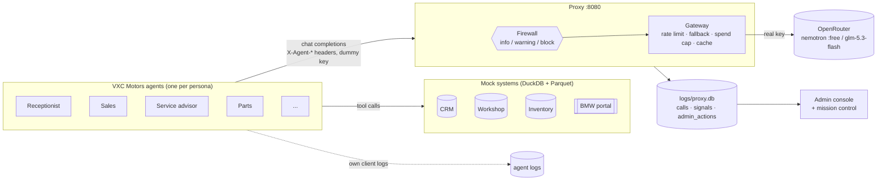

# VXC Motors · Agent Session Inspector — master plan

This repository is a learning project. It starts from one agent talking to an LLM and ends with a
whole simulated company, **VXC Motors** (a single-site BMW dealership with 12 staff), whose AI agents
talk to the LLM through a proxy that logs, inspects and, when needed, blocks their conversations,
while an administrator watches it all from a console.

Every step is a **lesson**. Each lesson has its own page under [`docs/lessons/`](lessons/) with the
same five parts: **summary**, **explanation**, **learnings**, **flowchart** (Mermaid) and a link to
its **visualization** (a self-contained HTML page under [`viz/`](../viz/), also published as an
artifact). The template is [`docs/templates/LESSON_TEMPLATE.md`](templates/LESSON_TEMPLATE.md).

## Lesson sequence

| # | Lesson | What it adds | Status | Page |
|---|---|---|---|---|
| 1 | Agent → OpenRouter | One agent with tools, calling the LLM directly in a loop | ✅ done | [01](lessons/01-agent-to-openrouter.md) |
| 2 | Agent via proxy | A pass-through proxy holds the real key; the agent only changes its base URL | ✅ done | [02](lessons/02-agent-via-proxy.md) |
| 3 | Proxy logging | Every exchange recorded in SQLite and readable turn by turn | ✅ done | [03](lessons/03-proxy-logging.md) |
| 3b | LLM gateway | Shared budget rules in the proxy: rate limit, backoff, daily-cap fallback, spend cap, replay cache | ✅ done | [03b](lessons/03b-llm-gateway.md) |
| 4 | Company & personas | VXC Motors: org chart, 12 personas (CV, background, illustrated avatar), Markdown + YAML as source of truth, loaded into a DB | 🔜 wave 1 | 04-company-and-personas.md |
| 5 | Mock systems & BMW portal | Internal systems (CRM, service workshop, inventory, parts, finance) in DuckDB + Parquet with history from Jan 2026, and an external BMW portal for ordering cars and parts | ⏳ wave 2 | 05-mock-systems.md |
| 6 | Multi-agent workday | One agent per persona, each with its tools, running a simulated workday through the proxy; each agent keeps its own client-side log | ⏳ wave 2 | 06-multi-agent-workday.md |
| 7 | Admin console | Web console over the logs: department → person → session → conversation, with LLM-written summaries and drill-down | ⏳ wave 4 | 07-admin-console.md |
| 8 | Sensitive topics | Five topic definitions detected by keywords **and** intent, levels info / warning / block, signals stored in their own table and highlighted in the console | ⏳ wave 3 | 08-sensitive-topics.md |
| 9 | Proxy firewall | Deep session inspection in the proxy: on *block* the proxy answers the agent itself, as if it were the LLM, and never forwards upstream; admin actions logged in their own table | ⏳ wave 3 | 09-proxy-firewall.md |
| 10 | Mission control, replay, demo | Live dashboard of agent activity, replay of a recorded day from the gateway cache, guided demo tour, published artifacts with log snapshots | ⏳ waves 4–5 | 10-mission-control.md |
| side | Walkable dealership | Three.js HTML model of the showroom and workshop; click a person to open their persona | ⏳ wave 1 | side-3d-dealership.md |

Status key: ✅ done · 🔜 in progress · ⏳ planned.

## Architecture (target)

## Decisions

| Topic | Decision |
|---|---|
| Company | VXC Motors, single-site BMW dealership, 12 staff, two business areas (sales, service) plus admin and supply chain |
| LLM | `nvidia/nemotron-3.5-super-vl:free`; `z-ai/glm-5.3-flash` **only** once the free daily cap is used up |
| Budget | ≤ 16 req/min across all agents, 1,000 free req/day (account-wide), paid fallback capped at **$3** (see lesson 3b) |
| Proxy log | SQLite `logs/proxy.db` (`calls` now; `signals` and `admin_actions` tables come with lessons 8–9) |
| Business data | DuckDB over Parquet files |
| Personas | Markdown with YAML frontmatter is the source of truth; loaded into the DB |
| Agent identity | `llm.make_client(agent_id, role=…, department=…)` sends `X-Agent-Id`, `X-Session-Id`, `X-Agent-*` labels; the proxy logs them as `labels` and strips them before forwarding |
| Sensitive topics | Customer PII leak, discount fraud, competitor poaching, harassment, credential sharing |
| Block behaviour | Proxy replies to the agent as if it were the LLM, with a "conversation blocked" message, and the session is not forwarded |
| Visualizations | Self-contained HTML under `viz/`, published as artifacts; log snapshots embedded with `viz/embed_log.py` |

## How the work is organised

- **Branches**: `main` is untouched. `vxc-motors` is the integration branch. Each piece of work uses
  its own feature branch off `vxc-motors`, commits and pushes often, and merges back when done.
- **Waves**: 1) foundation, docs, company and personas, 3D dealership · 2) mock systems and
  multi-agent runner · 3) sensitive topics and firewall · 4) console, mission control, replay ·
  5) demo tour, docs polish, final run.
- **Every agent uses the shared LLM layer** (`llm/`) and goes through the proxy, so the budget rules
  hold no matter how many agents run.
- **Each lesson is finished** when its page has all five parts, its visualization is in `viz/` and
  published, and this table says ✅.

## Visualizations so far

| Viz | Lesson | Repo | Published |
|---|---|---|---|
| Session sequence diagram (A2) | 3 | [`viz/sequence.html`](../viz/sequence.html) | https://claude.ai/artifact/6jZ5vsA2nbnXobh5YEwvMq |
| Topology map, steps 1–3 (B1) | 1–3 | [`viz/topology.html`](../viz/topology.html) | https://claude.ai/artifact/UXRUbzzXEv6XJGRBCA3ubP |
