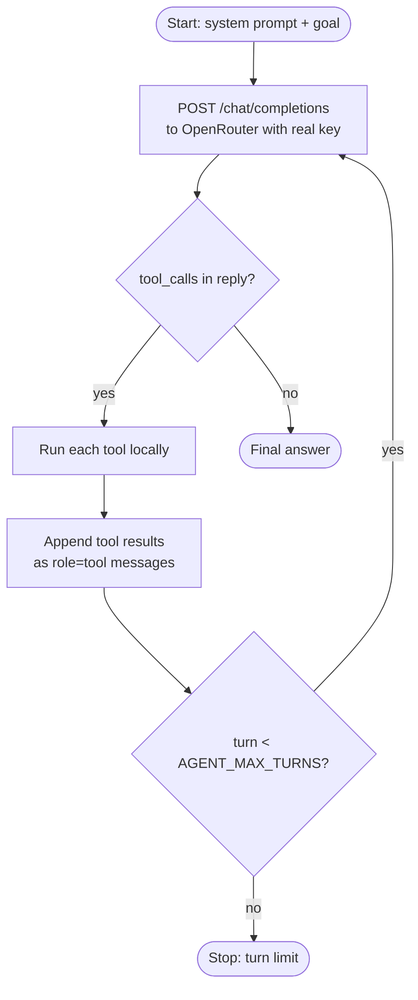

# Lesson 1 · Agent → OpenRouter

> **Status:** done · **Code:** [`agent/agent.py`](../../agent/agent.py) · **Visualization:** [viz/topology.html](../../viz/topology.html) (tab *Step 1 · Direct*) · [published](https://claude.ai/artifact/UXRUbzzXEv6XJGRBCA3ubP)

## Summary

The smallest useful agent: a Python loop that sends a conversation to an LLM through the
OpenAI-compatible Chat Completions API on OpenRouter, runs any tools the model asks for, appends the
results, and repeats until the model gives a final answer. Everything later in the project is built
around this loop.

## Explanation

An **agent** here is three things: a goal, a set of tools, and a loop.

1. **Configuration** comes from environment variables: `LLM_BASE_URL` (default
   `https://openrouter.ai/api/v1`), `LLM_API_KEY` (falls back to `OPENROUTER_API_KEY`), `LLM_MODEL`
   (default `nvidia/nemotron-3.5-super-vl:free`), `AGENT_GOAL` and `AGENT_MAX_TURNS`.
2. **The conversation** starts with a system prompt and the goal as the user message.
3. **Each turn** calls `client.chat.completions.create(model, messages, tools, reasoning)`. The model
   either answers (no `tool_calls`, `finish_reason=stop`) or asks for one or more tools
   (`finish_reason=tool_calls`).
4. **Tools run locally** inside the agent: `current_time`, `calculator`, and a tiny fake shop
   (`get_order`, `get_customer`, `get_shipping`). Each result goes back as a `role: tool` message
   with the matching `tool_call_id`.
5. **The loop stops** on a final answer or when `AGENT_MAX_TURNS` is reached.

```python
for turn in range(1, MAX_TURNS + 1):
    resp = client.chat.completions.create(model=MODEL, messages=messages, tools=TOOL_SPECS,
                                          extra_body={"reasoning": {"enabled": True}})
    msg = resp.choices[0].message
    messages.append(msg.model_dump(exclude_none=True))
    if not msg.tool_calls:
        return 0                      # final answer
    for call in msg.tool_calls:      # run each tool and feed the result back
        result = TOOLS[call.function.name](**json.loads(call.function.arguments or "{}"))
        messages.append({"role": "tool", "tool_call_id": call.id, "content": result})
```

The order-support goal ("what will order A-1001 cost in total?") needs five calls: order →
customer (loyalty discount) → shipping rate → calculator → answer. Each call re-sends the **whole**
conversation; the LLM is stateless.

## Learnings

- The LLM never runs code. It only *asks* for a tool; the agent decides whether and how to run it.
- Each request carries the full history, so token use grows every turn. This matters for the budget
  once many agents run (lesson 3b).
- OpenRouter speaks the OpenAI API, so the stock `openai` SDK works with only a different base URL.
  That is what makes the proxy in lesson 2 possible.
- With the key inside the agent, every agent process holds a real secret. Lesson 2 removes that.
- Free models can be slow or busy; a reasoning-capable free model still follows the tool protocol well.

## Flowchart



## Visualization

[`viz/topology.html`](../../viz/topology.html), tab **Step 1 · Direct**: the agent and OpenRouter
boxes with the request and response links. Press **Play turn** to step through one turn; click a box
to see its configuration and the key code.
Published: https://claude.ai/artifact/UXRUbzzXEv6XJGRBCA3ubP

## Try it

```
pip install -r requirements.txt
export OPENROUTER_API_KEY=...
python3 agent/agent.py
```
