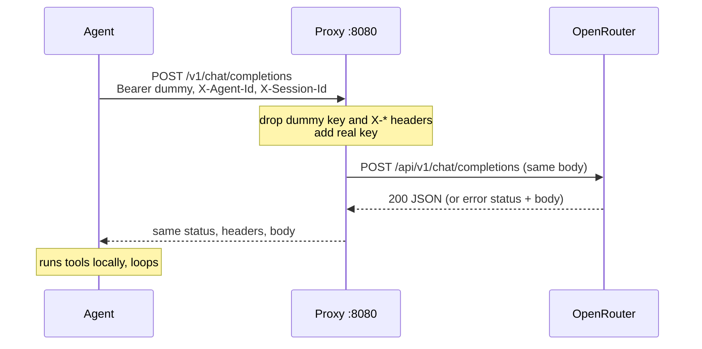

# Lesson 2 · Agent via proxy

> **Status:** done · **Code:** [`proxy/proxy.py`](../../proxy/proxy.py) · **Visualization:** [viz/topology.html](../../viz/topology.html) (tab *Step 2 · Pass-through*) · [published](https://claude.ai/artifact/UXRUbzzXEv6XJGRBCA3ubP)

## Summary

A small HTTP proxy sits between the agent and OpenRouter. The agent changes only its base URL and
sends a dummy key; the proxy swaps in the real key and forwards the request unchanged. The agent
cannot tell the difference, and from now on every LLM call passes through one place we control.

## Explanation

- The proxy is a `ThreadingHTTPServer` on `127.0.0.1:8080`. It accepts any `GET`/`POST` under
  `/v1/…` and forwards it to `UPSTREAM_BASE_URL` (default `https://openrouter.ai/api/v1`).
- **Request headers**: it drops hop-by-hop headers (`Host`, `Content-Length`, `Connection`, …),
  drops the agent's `Authorization`, and sets `Authorization: Bearer <OPENROUTER_API_KEY>`. Only the
  proxy process has the real key.
- **Identity headers**: the agent names itself with `X-Agent-Id` and a per-run `X-Session-Id`
  (and, from lesson 3b, optional `X-Agent-*` labels such as role and department). The proxy reads
  them and strips them before forwarding, so the provider never sees them.
- **Body**: forwarded byte for byte.
- **Responses and errors**: the provider's status, headers and body go back to the agent as they are
  (minus transfer headers). A provider error stays a provider error. If the provider cannot be reached,
  the proxy returns a `502` with an OpenAI-style error body.
- No streaming: the proxy reads the full response, which keeps it simple and makes inspection
  (lessons 3, 8, 9) possible.

Agent side, the only change is configuration:

```
LLM_BASE_URL=http://127.0.0.1:8080/v1 LLM_API_KEY=dummy python3 agent/agent.py
```

## Learnings

- Because the API is OpenAI-compatible, the proxy is invisible: no SDK change, no code change.
- Moving the key out of the agents is a security win before any inspection is added.
- A proxy that forwards whole (non-streamed) messages is what later allows it to read, judge and
  block a conversation before the agent sees the answer.
- With the gateway (lesson 3b) the proxy is also where account-wide limits are enforced. For the pure
  step-2 behaviour, run it with `PROXY_GATEWAY=off`.

## Flowchart



## Visualization

[`viz/topology.html`](../../viz/topology.html), tab **Step 2 · Pass-through**: the proxy appears
between agent and OpenRouter; the links show which key each hop carries. Click **Proxy** → **Key
code** for `_forward`.
Published: https://claude.ai/artifact/UXRUbzzXEv6XJGRBCA3ubP

## Try it

```
PROXY_GATEWAY=off python3 proxy/proxy.py          # terminal 1: plain pass-through
LLM_BASE_URL=http://127.0.0.1:8080/v1 LLM_API_KEY=dummy python3 agent/agent.py   # terminal 2
```
