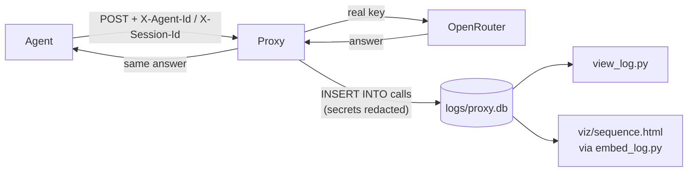

# Lesson 3 · Proxy logging

> **Status:** done · **Code:** [`proxy/proxy.py`](../../proxy/proxy.py) (`log_call`), [`proxy/view_log.py`](../../proxy/view_log.py) · **Visualization:** [viz/sequence.html](../../viz/sequence.html) · [published](https://claude.ai/artifact/6jZ5vsA2nbnXobh5YEwvMq)

## Summary

With `PROXY_LOGGING=on`, the proxy writes one SQLite row per LLM call: who called, in which
session, the full request and response, timing, usage and errors, with secrets redacted. Grouping
rows by session gives back whole conversations, turn by turn. This log is the raw material for the
console, the sensitive-topic detection and the firewall.

## Explanation

- **Where**: `logs/proxy.db` (`PROXY_LOG_DB`), gitignored. One table, `calls`:

  | column | meaning |
  |---|---|
  | `id`, `ts`, `duration_ms` | row id, UTC start time, round-trip time |
  | `agent`, `session` | from `X-Agent-Id`, `X-Session-Id` |
  | `method`, `path`, `status` | the HTTP exchange |
  | `model`, `finish_reason`, `usage` | from the request and the provider's answer |
  | `error` | provider or proxy error, if any |
  | `request`, `response` | full JSON bodies, key redacted |
  | `route`, `upstream_model`, `attempts`, `cost_usd`, `labels` | added by the gateway (lesson 3b); older files get these columns on first write |

- **When**: after the provider answers and before the reply goes back. A failed write prints a
  warning and never touches the agent's reply.
- **Redaction**: the real key and any `Bearer …` token are replaced by `[REDACTED]` before storing.
- **Reading**: `proxy/view_log.py` lists sessions (calls, errors, tokens); `view_log.py <session>`
  prints the conversation with assistant text, tool calls and tool results.
- **Reconstructing a conversation**: each request carries the full history, so call *n+1*'s
  messages contain call *n*'s answer and the tool results. The viewer and the sequence diagram use
  that to show what was new in each turn.

## Learnings

- One row per call is enough to rebuild the whole session: the stateless API means each request is
  a complete snapshot.
- Tool execution never passes through the proxy. We only see a tool's **result** in the next
  request. The sequence diagram marks those steps as local to the agent.
- Logging must be fail-safe: inspection is never allowed to break the agent.
- Full bodies are big (each turn repeats the history). Fine for a dozen agents; a larger system
  would store deltas.
- The log is the proxy's point of view. In lesson 6 each agent also keeps its own log, so a blocked
  session (lesson 9) can be seen from both sides.

## Flowchart



## Visualization

[`viz/sequence.html`](../../viz/sequence.html): a lane diagram (Agent · Proxy · OpenRouter · Log DB)
of real logged sessions: the 5-call order-support run, a 2-call clock run and a failed call with a
bad model id. Click any arrow to see its fields and the raw request, response or stored row. Local
tool runs appear as boxes on the agent lane.
Published: https://claude.ai/artifact/6jZ5vsA2nbnXobh5YEwvMq

The data is embedded in the page. To show a fresh run:

```
python3 viz/embed_log.py                       # all of logs/proxy.db
python3 viz/embed_log.py --session <id>        # one session
```

The topology map ([`viz/topology.html`](../../viz/topology.html), tab **Step 3 · Logging**) shows
where the log DB sits.

## Try it

```
PROXY_LOGGING=on python3 proxy/proxy.py
LLM_BASE_URL=http://127.0.0.1:8080/v1 LLM_API_KEY=dummy AGENT_ID=clock-bot python3 agent/agent.py
python3 proxy/view_log.py
python3 proxy/view_log.py <session>
```
