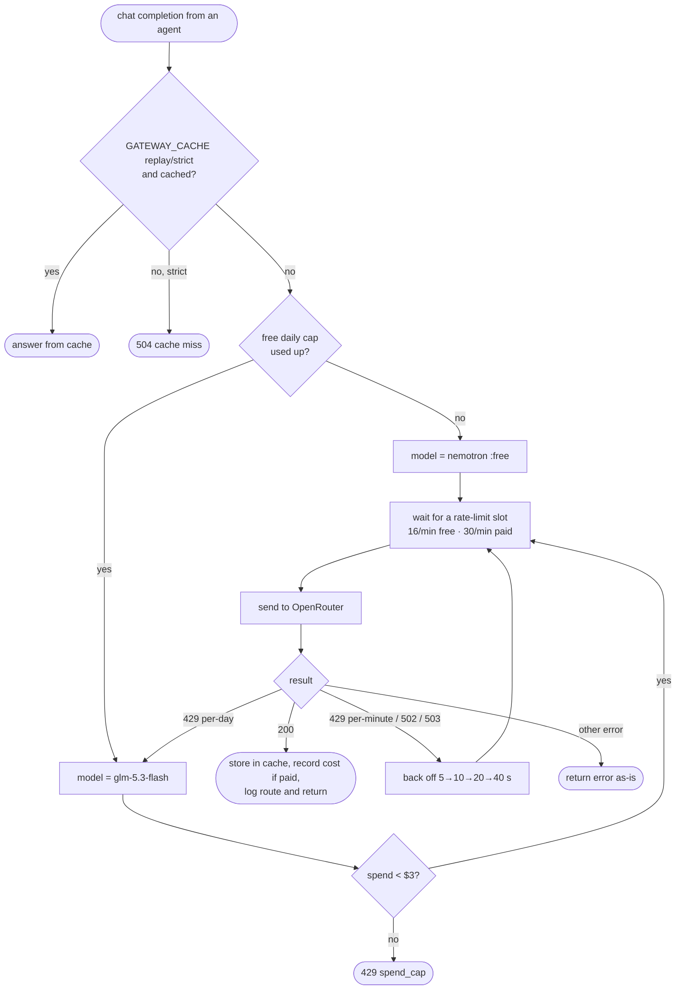

# Lesson 3b · LLM gateway: shared budget for many agents

> **Status:** done · **Code:** [`proxy/gateway.py`](../../proxy/gateway.py), [`llm/`](../../llm/), [`tests/test_gateway.py`](../../tests/test_gateway.py) · **Visualization:** live JSON at `GET /v1/gateway/status`; per-call `route` field in [viz/sequence.html](../../viz/sequence.html) · [published](https://claude.ai/artifact/6jZ5vsA2nbnXobh5YEwvMq)

## Summary

Twelve agents share one OpenRouter account, and the limits are per account, not per agent. So the
proxy, the one place every call passes, now also acts as a **gateway**: it paces requests under the
free per-minute limit, retries busy moments on the free model, switches to a cheap paid model only
once the free **daily** cap is spent, stops paid traffic at a hard spend cap, and caches every answer
so a recorded day can be replayed for free. Agents get all of this by using the shared `llm` module.

## Explanation

### The budget we work with (measured 2026-10-27 via `GET /api/v1/key`)

| Item | Value |
|---|---|
| Free models (`…:free`) | **20 req/min** and **1,000 req/day**, shared by every free model on the account (the account bought ≥ $10 of credits) |
| Daily reset | 00:00 UTC |
| Key spend limit | $8.00 (spent $0.00 at setup) |
| Key expiry | 2026-11-03 06:49 UTC |
| Free requests used on setup day | 29 of 1,000 at 21:15 UTC |
| Primary model | `nvidia/nemotron-3.5-super-vl:free`, $0, 1M context |
| Fallback model | `z-ai/glm-5.3-flash`, $0.15 / 1M input, $0.50 / 1M output, 1M context |
| Fallback spend cap (ours) | **$3.00** |

Extra keys, accounts or other free models do not add capacity. Paid models have no request cap,
only cost. A smoke call to the fallback (18 prompt + 223 completion tokens, mostly reasoning) cost
$0.000114, so $3 is roughly 25,000 such calls.

### The rules, in the order the gateway applies them

```python
status, headers, data, meta = GATEWAY.chat(path, body, headers)   # in proxy._forward
```

1. **Replay cache.** The cache key is a SHA-256 of the request JSON (minus `user`/`stream`).
   `GATEWAY_CACHE=record` (default) stores every successful answer; `replay` answers from the cache
   first and goes upstream on a miss; `strict` never goes upstream (a miss is a `504`).
2. **Daily cap check.** The gateway reads `free_model_daily_requests` from `GET /key` at most once a
   minute and subtracts its own calls since that reading. When nothing is left, or OpenRouter answers
   `429` mentioning the per-day limit, free requests are routed to the fallback until next 00:00 UTC.
3. **Spend cap.** Before any paid call: `max(local ledger, key usage) < GATEWAY_SPEND_CAP_USD`,
   otherwise a `429` with `metadata.gateway = "spend_cap"`.
4. **Rate limit.** A sliding 60-second window per tier: 16/min free (below the 20 allowed), 30/min
   paid. A caller waits for a slot (up to `GATEWAY_MAX_WAIT_S`) instead of failing.
5. **Backoff.** A per-minute `429`, `502` or `503` is retried **on the same free model**, 5 s,
   10 s, 20 s, 40 s (or longer if `Retry-After` says so). These never trigger the paid fallback.
6. **Ledger.** Paid answers record their cost (`usage.cost` from OpenRouter, or an estimate from
   tokens) in `logs/gateway.db`.

The proxy log gains `route` (`primary`, `fallback`, `direct`, `cache`, `refused`, `passthrough`),
`upstream_model`, `attempts`, `cost_usd` and the agent's `labels`. The reply carries an
`X-Gateway-Route` header.

### Agent side: `llm/`

```python
from llm import make_client, chat, start_proxy

start_proxy()                                    # starts proxy/proxy.py with logging if not running
client, session = make_client("sales-anna", role="sales", department="sales")
resp = chat(client, messages, tools=TOOL_SPECS)
```

`make_client` points the OpenAI SDK at `http://127.0.0.1:8080/v1` with a dummy key, adds
`X-Agent-Id`, `X-Session-Id` and `X-Agent-<Label>` headers, and turns off the SDK's own retries (the
gateway already retries; double retries would multiply requests). `chat` retries a 429/5xx that got
through twice more, but never a budget refusal.

## Learnings

- Shared quotas belong at a shared choke point. Limiting inside each agent cannot see the others.
- Waiting is better than failing: a queued request costs a few seconds; a failed one costs a whole
  agent turn and usually a retry anyway.
- Not every 429 means the same thing. Per-minute and provider-busy errors are retried for free;
  only the per-day cap is a reason to spend money. (This was the user's rule: the paid model is for
  after the 1,000/day is gone.)
- Trust the provider's own counters (`/key`) over local ones, but count locally between readings so
  a burst does not overshoot.
- Caching by request hash makes replays deterministic and free, which is what the demo and replay
  mode (lesson 10) need. A live run with a changed prompt or tool result simply misses the cache.

## Flowchart



## Visualization

The gateway's state is a live JSON document: `curl http://127.0.0.1:8080/v1/gateway/status`
shows free requests used and left today, requests in the last minute per tier, paid spend against
the cap, and cache size. Mission control (lesson 10) draws the proxy as one node labelled *firewall · gateway · log*
rather than a separate gateway panel; the budget numbers stay in this JSON. The `route` column in
the log also shows up in [`viz/sequence.html`](../../viz/sequence.html) as a *gateway route* field on
the forward hop.

## Try it

```
python3 -m unittest -v tests.test_gateway        # 11 tests against a fake OpenRouter, no network
PROXY_LOGGING=on python3 proxy/proxy.py
curl -s http://127.0.0.1:8080/v1/gateway/status
GATEWAY_CACHE=replay PROXY_LOGGING=on python3 proxy/proxy.py   # replay a recorded run
```

All settings are listed at the top of [`proxy/gateway.py`](../../proxy/gateway.py).
