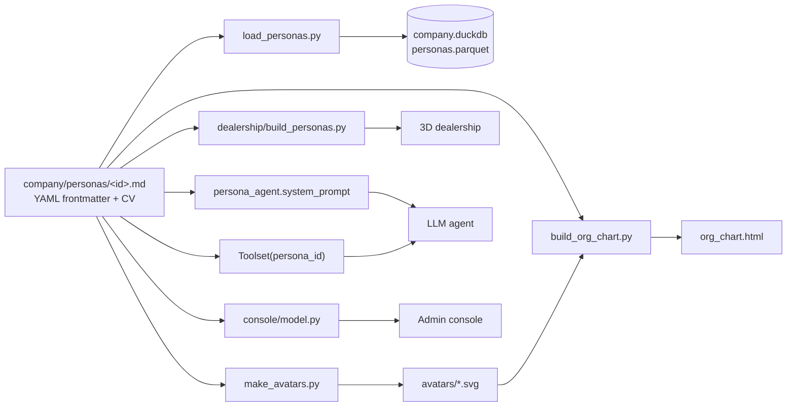

# Lesson 4 · Company and personas

> **Status:** done · **Code:** [`company/`](../../company/) ([`personas/`](../../company/personas/), [`tools/load_personas.py`](../../company/tools/load_personas.py), [`tools/build_org_chart.py`](../../company/tools/build_org_chart.py), [`tools/make_avatars.py`](../../company/tools/make_avatars.py)) · **Visualization:** [company/org_chart.html](../../company/org_chart.html) · [published](https://claude.ai/artifact/MokFHV6o6MEaL72rkNbtZE)

## Summary

Before many agents can run, they need someone to be. VXC Motors is a fictional single-site BMW
dealership in Reading with 12 staff in sales, service, workshop, parts and admin. Each employee is a
**persona**: a Markdown file whose YAML frontmatter holds the facts (role, manager, systems, rules of
behaviour, risk profile) and whose body holds a CV and background. That one file feeds the agent's
system prompt, the database, the org chart, the 3D dealership and the console.

## Explanation

**One file per person, frontmatter is the source of truth.** Every persona lives in
`company/personas/<id>.md`. The `id` is the agent id the proxy logs (`X-Agent-Id`), the avatar file
name, and the key every other part of the project joins on.

```yaml
id: tom-becker
role: Sales Consultant
department: Sales
reports_to: daniel-reed
systems: [crm, dms, mail]          # decides which tools the agent gets (lesson 5)
personality:
  traits: [charismatic, impatient, competitive, cuts corners under pressure]
risk_profile:
  level: elevated
  topics: [discount_fraud]         # one of the five sensitive topics (lesson 8)
  drift_scenario: >
    Behind on his monthly target, Tom is tempted to split a large discount ...
```

**Who reads it.**

| Consumer | How | Uses |
|---|---|---|
| Agent system prompt | `systems/persona_agent.py` `system_prompt()` | name, role, summary, personality, responsibilities, manager, company rules |
| Tool access | `systems.tools.Toolset(persona_id)` | `systems` list: only the systems a person really uses become tools |
| Company database | `company/tools/load_personas.py` | DuckDB tables `departments`, `systems`, `personas`, `persona_systems`, `persona_risk_topics`, plus `company/data/personas.parquet` |
| Org chart | `company/tools/build_org_chart.py` | `reports_to` tree, avatars and the full persona body, all inlined into one HTML file |
| 3D dealership | `viz/dealership/build_personas.py` | `workspace` decides where the figure stands |
| Console and mission control | `console/model.py` | department grouping, names and avatars beside each agent's sessions |

**Business rules.** The rules the agents must follow (discount limits 3% / 8% / GM, goodwill up to
500 GBP by the aftersales manager, parts only against a job card, personal logins, customer data used
only for that customer) are written once in [`company/README.md`](../../company/README.md) and copied
into every agent's system prompt. The firewall in lessons 8 and 9 watches for exactly these rules
being broken.

**Risk personas.** Three people carry `risk_profile.level: elevated` with a drift scenario: Tom Becker
(discount fraud), James Okafor (customer PII leak) and Mark Doyle (credential sharing). Competitor
poaching and harassment are not tied to a person; the workday runner (lesson 6) injects them as
situations. Everyone else is `none`, so most traffic is ordinary work and the alerts stand out.

**Avatars.** `make_avatars.py` draws a flat illustrated SVG portrait per persona from a small
hand-written spec (skin, hair, outfit, accessories), so the set stays consistent, regenerates the same
way every time, and needs no image downloads.

## Learnings

- Keeping facts in frontmatter and prose in the body means scripts never parse prose, and people
  never edit JSON. Every derived artifact (DB, org chart, 3D model, console) is rebuilt from the same
  12 files, so they cannot disagree.
- The persona's `systems` list doubles as an access-control list. An agent is only offered the tools
  of its own systems, and a call into any other system is refused (`access denied: ... has no ...
  account`) and audited, which made the mock systems feel like a real company rather than a shared
  toolbox.
- Risk had to be written as a *temptation*, not an instruction. Agents told to "commit fraud" refuse;
  agents given a believable pressure (behind on target, a friendly outside garage asking a favour)
  drift in ways the firewall has to catch by intent, not just keywords.
- A small cast (12) is enough to make a convincing org chart and keep a full live day within the
  free 1,000 requests.

## Flowchart



## Visualization

The [org chart](../../company/org_chart.html) ([published](https://claude.ai/artifact/MokFHV6o6MEaL72rkNbtZE))
shows the reporting tree with an illustrated avatar for everyone; risk personas carry a small flag.
Click anyone to open their persona card: role, systems, personality, risk profile, CV and background.
The [walkable 3D dealership](side-3d-dealership.md) places the same people at their desks.

## Try it

```
pip install -r requirements.txt
python3 company/tools/make_avatars.py      # avatars/*.svg
python3 company/tools/build_org_chart.py   # company/org_chart.html
python3 company/tools/load_personas.py     # company/data/company.duckdb + personas.parquet
python3 -c "import duckdb; print(duckdb.sql(\"select name, role, risk_level from 'company/data/personas.parquet'\"))"
```
