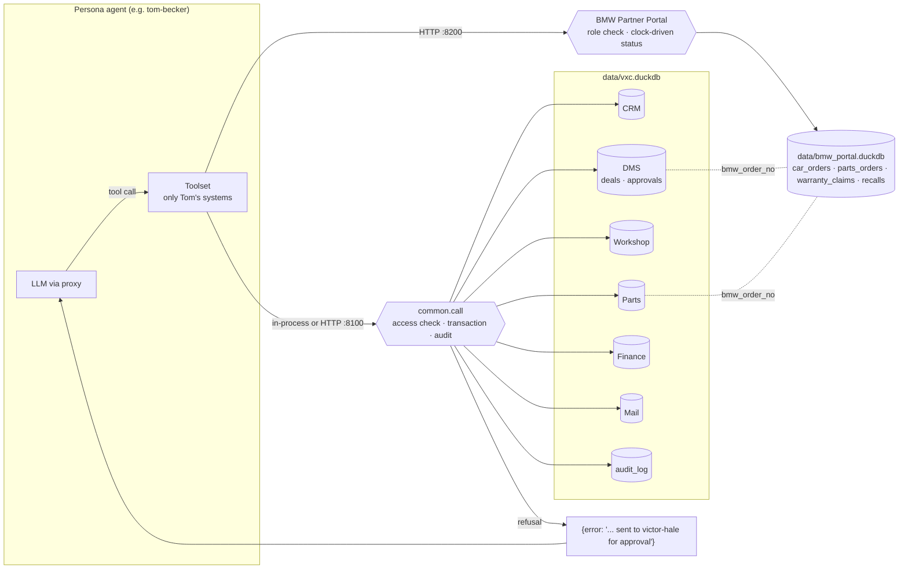

# Lesson 5 · Mock systems & BMW portal

> **Status:** done · **Code:** `systems/` · **Visualization:** [viz/data-model.html](../../viz/data-model.html) · [published](https://claude.ai/artifact/3xztnSwWvZtCpjuMa314td)

## Summary

VXC Motors now has working systems for its agents to use: a CRM, a dealer management system (stock,
deals, discounts, approvals), a workshop planner, parts inventory, finance, and email, plus BMW's
partner portal as a separate external service. Each operation is a **tool**: a Python function with a
JSON-schema definition that the tool-calling agent from lesson 1 can call. A seeded simulation fills
both databases with ten months of history (January 2026 to the morning of 27 October 2026) and leaves
real open work waiting in every person's queue.

## Explanation

**Two databases.** The dealership's systems share `data/vxc.duckdb` (21 tables). BMW's portal keeps
its own `data/bmw_portal.duckdb` (12 tables) and knows nothing about the dealer's internals; the two
sides are linked only by values such as BMW order numbers (`vehicles.bmw_order_no`) and job references
(`warranty_claims.job_ref`). A snapshot of every table is written to `data/parquet/<db>/<table>.parquet`
and committed, so the data can be read without running anything (`duckdb -c "SELECT * FROM
'data/parquet/internal/deals.parquet'"`). The `.duckdb` files are rebuilt on first use.

**Tools.** Each system module registers its operations with a decorator:

```python
@tool("dms", "Set the price on a deal. Discounts above your limit ... send an approval request ...",
      writes=True, deal_id=Param("string", "Deal id"),
      discount_pct=Param("number", "Discount as % of list price, e.g. 4.5"),
      reason=Param("string", "Why this discount is justified"), ...)
def dms_set_deal_price(ctx, deal_id, discount_pct, reason, accessories_amount=0, trade_in_value=None):
    ...
```

`ctx.actor` is the persona calling, `ctx.db` a DuckDB cursor, `ctx.now` the simulation clock
(`VXC_NOW`, else real time). `systems.common.call(actor, tool, args)` is the single entry point: it
checks the persona has an account on that system (from the persona's `systems` list), runs the tool in
a transaction, and writes one row to `audit_log` (or BMW's `portal_access_log`) whether the call
succeeded or was refused. 69 tools in all, prefixed by system: `crm_`, `dms_`, `workshop_`, `parts_`,
`finance_`, `mail_`, `bmw_`.

**Per-persona toolsets.** `Toolset("tom-becker").specs` gives only the tools for Tom's systems
(CRM, DMS, mail: 29 tools); Elena, who touches six systems, gets 63. `Toolset.call(name, args)`
returns a JSON string for the `tool` message, with refusals as `{"error": "..."}` so the model can read
why and react.

**Business rules live in the tools,** not in the prompt alone (`systems/rules.py`): a consultant's
discount over 3% (sales manager over 8%) holds the deal in `pending_approval` and creates an
`approvals` row for the right manager; a fourth stock car in a week needs the General Manager; parts
are only issued against a real job card; a new car cannot be handed over before its PDI; extra workshop
work must be authorised before a job can close; the BMW portal checks each user's portal role.

**The portal runs on the clock.** A car order moves confirmed → in_production → shipped → delivered
as the weeks of its model's lead time pass (and gets a VIN in production); parts arrive at 07:30 the
next morning (a VOR order placed before 10:00 arrives the same afternoon); warranty claims are decided
three days after submission. Nothing pushes these changes into the dealer's systems: someone (Mark)
has to notice the delivery and book it in, just as in a real dealership.

**History and this morning.** `systems/seed.py` walks every day from 1 January: leads arrive (more in
the March and September plate months), about 30% become deals, new cars are ordered from BMW and
arrive weeks later, trade-ins become used stock, customers book services, technicians use parts, the
parts counter reorders at 15:00, finance invoices and gets paid, and every transaction posts balanced
ledger lines. `systems/scenario_today.py` then leaves the loose ends a Tuesday morning would have:
overnight web leads for Maria to route, a customer asking Tom for 10% off an M4, Sofia's 5.5% discount
waiting for Daniel, a fourth stock order waiting for Victor, two cars BMW delivered yesterday, a VOR
water pump waiting to be booked in, a warranty claim and a goodwill request for Elena, and unread
email for most of the team. The seed is fixed, so every build is identical.

**Sharing across processes.** DuckDB allows one writing process per file. In one process the systems
share a connection behind a lock. For several agent processes, run `python -m systems.server internal`
(port 8100) and `python -m systems.server bmw_portal` (port 8200) and set `VXC_INTERNAL_URL` /
`VXC_PORTAL_URL`; `Toolset` then calls over HTTP with the same results.

## Learnings

- Putting the rules in the tools makes a refusal visible: the model gets `"10% is above your 3% limit;
  approval request AP-00237 sent to victor-hale"` and follows the process. In the first live run, Tom's
  agent did exactly that, then told the customer the discount was "with our GM for sign-off". Lesson 9's
  firewall can now watch what an agent tries to *say* about a refusal, not only what it does.
- The audit log records refusals too. A string of denied calls from one persona is itself a signal.
- A tool called `crm_export_customers` exists on purpose: exporting is a legitimate internal job, and
  the risk (James sending the file to an outside garage) shows up in what happens next. Every export is
  logged in `activities`.
- Free models handle 30 to 60 tools well enough, but long descriptions cost tokens on every turn. Tool
  descriptions are kept to one or two sentences and carry the rule that matters.
- DuckDB 2.0 reserves `at` as a keyword, so time columns are named `occurred_at`. Bulk seeding goes
  through CSV and `COPY`, which builds 30,000 rows in about two seconds; row-by-row `executemany` would
  take minutes.
- Retail prices include 20% VAT and dealer costs do not. Getting that wrong made the first seeded
  dealership sell every car at a loss; the test suite now checks the books balance.

## Flowchart



## Visualization

[`viz/data-model.html`](../../viz/data-model.html) ([published](https://claude.ai/artifact/3xztnSwWvZtCpjuMa314td))
shows both databases side by side, grouped by system. Pick a table to highlight what it links to (dashed
orange links cross to the other database), list the tools that read or write it, and see three real rows
from the seed. Rebuild with `python viz/build_data_model.py` after reseeding.

## Try it

```
pip install -r requirements.txt
python -m systems.seed                                   # rebuild data/*.duckdb and data/parquet/** (~2 s)
python -m systems.cli                                    # personas and their tool counts
python -m systems.cli tom-becker mail_inbox              # what Tom finds this morning
python -m systems.cli tom-becker dms_set_deal_price '{"deal_id": "D-00176", "discount_pct": 10, "reason": "match"}'
python3 -m unittest -v tests.test_systems               # 19 tests: rules, flows, HTTP mode

# one persona agent through the proxy, clock pinned to the seed morning
python proxy/proxy.py &
VXC_NOW=2026-10-27T08:30:00 python -m systems.persona_agent mark-doyle "Start your day: check your inbox, BMW deliveries and parts requests."
```
