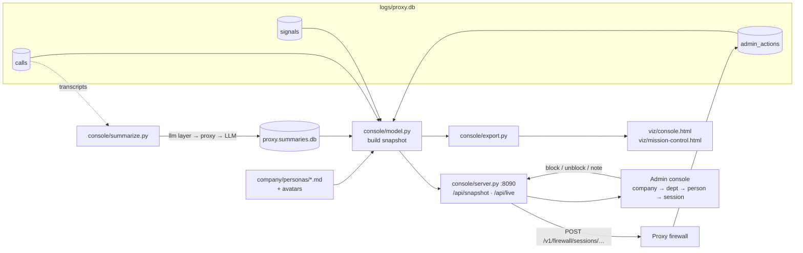

# Lesson 7 · Admin console

> **Status:** done · **Code:** [`console/`](../../console/) (`model.py`, `server.py`, `summarize.py`, `web/console.html`) · **Visualization:** [viz/console.html](../../viz/console.html) · [published](https://claude.ai/artifact/4qKXJBDNUJXZNcUJKNvipu)

## Summary

The proxy log answers "what did the agents say?", but only one row at a time. The admin console turns
it into something a manager can read: VXC Motors → department → person → session → conversation,
with a written summary at every level, the firewall's alerts beside it, and buttons to block, unblock
or annotate a session. The administrator can rely on the summaries and drill down only where an
alert or a summary says it is worth it.

## Explanation

**One model, three consumers.** [`console/model.py`](../../console/model.py) reads the log and the
personas and builds one JSON snapshot. The live server, the static export and mission control
(lesson 10) all use that same snapshot, so a published page shows exactly what the live console showed.

| Source | What the console takes from it |
|---|---|
| `calls` (lesson 3) | every LLM call: `agent`, `session`, `ts`, full `request` / `response`, `usage`, `route`, `labels` (role, department), `firewall_level` |
| `signals` (lesson 8) | one row per finding: `level` info/warning/block, `topic`, `detector`, `matched`, `rationale`, `confidence`, `call_id`, `direction` |
| `admin_actions` (lesson 9) | `block_session`, `unblock_session`, `replace_response`, `note`, by the firewall or a named admin |
| `company/personas/*.md` | name, role, department, reporting line, systems, traits, risk profile, illustrated avatar |
| `<log>.summaries.db` | cached LLM summaries (below) |

Every table except `calls` is optional: on a log written before the firewall existed, the console
simply shows no alerts.

**The hierarchy.** Department comes from the persona file (falling back to the `X-Agent-Department`
label, then "Unassigned"), so an agent that is not a persona still gets a place in the tree.

```
VXC Motors            company summary, KPIs, activity timeline, sensitive-topic cards
└─ Sales              department summary, people, all sessions
   └─ Tom Becker      persona card (avatar, CV facts, risk profile) + activity summary + sessions
      └─ 10:40 session  summary, admin buttons, full conversation with tool calls and highlighted signals
```

**Rebuilding a conversation.** Each request carries the whole history, so only the messages beyond
what the previous call already showed are new (`model.conversation`). Every message is tagged with
the call that first carried it, and each signal is pinned by `call_id` and `direction` to either the
request side (the person's message or a tool result) or the reply. The page then highlights the
signal's `matched` text inside the message. When the firewall answered instead of the LLM
(`route = firewall`), the reply is drawn in red and labelled "Firewall (answering as the LLM)".

**Summaries at every level.** Two kinds, and the page always says which one you are reading:

- *Rule-based* (always available, no network): the first ask, the tools used, the outcome, and any
  alert. People, departments and the company get counts plus the blocked people.
- *LLM-written* (`python3 console/summarize.py [log]`): bottom-up, one request per session, then per
  person from the session summaries, per department from the people, and one company brief. Each is
  stored with the log position it describes (`version` = last call id), and the console uses it only
  while it is current. Requests go through the shared `llm` layer and the proxy, so the gateway's
  rate limit and budget apply; they are sent as agent `console-summarizer`, which the console leaves
  out of its own views. The demo day costs about 50 free requests, once.

```python
# console/summarize.py: nemotron reasons before answering; for a summary that only burns tokens
llm.chat(client, messages, max_tokens=700, temperature=0.2, extra_body={"reasoning": {"enabled": False}})
```

**Admin actions.** On a session page the administrator can block, unblock or add a note. The
console server forwards these to the proxy's firewall endpoint
(`POST /v1/firewall/sessions/<id>/block|unblock|note`, with `X-Admin-Token` when
`FIREWALL_ADMIN_TOKEN` is set), so the proxy enforces them on the next request. If the proxy is not
running, the action is written straight into `admin_actions`, where the firewall reads it. Every
action shows up in the session's history and in the alert rail.

**Live and snapshot.** `python3 console/server.py` serves the console at `:8090` and rebuilds the
snapshot whenever the log's fingerprint (max id and count of each table) changes; the page polls every
4 seconds. `python3 console/export.py` bakes the snapshot into `viz/console.html` as
`window.SNAPSHOT`; that copy is read-only and works offline and as a published artifact.

## Learnings

- **The log already had everything.** No new logging was needed: the full request bodies are enough
  to rebuild every conversation, and the `labels` the `llm` layer sends give each call a department.
- **Summaries need a version.** A summary of a session that is still running goes stale. Keying each
  cached summary to the last call it saw makes "is this summary current?" a cheap comparison.
- **Reasoning models and short outputs do not mix.** The first summary run returned empty answers:
  nemotron spent the whole `max_tokens` thinking (`finish_reason: length`, `content: null`).
  Turning reasoning off for this task fixed it.
- **The console's own LLM traffic is also traffic.** Summaries go through the proxy like any agent,
  so they are logged; the console filters its own agent id out instead of bypassing the proxy.
- **The firewall must not inspect the inspector.** On the first real day, the summariser sent every
  transcript in one session; those transcripts quote the incidents (disguised discounts, passwords),
  so the firewall escalated and blocked the summariser, and 126 of 130 summaries came back as the block
  message. Now each summary uses a fresh session, and the proxy exempts `console-summarizer`
  (`FIREWALL_EXEMPT_AGENTS`; with `FIREWALL_ADMIN_TOKEN` set the exemption also needs `X-Admin-Token`,
  so a staff agent cannot claim it by name).
- **Say where a sentence came from.** The page labels every summary "LLM summary" or "Rule-based
  summary". An administrator acting on an alert needs to know whether a model or a rule wrote it.
- **Signals are pinned to a side.** A finding on the person's message and a finding on the LLM's
  reply mean different things (the person asked for it, or the model offered it), so the console
  keeps `direction` visible.

## Flowchart



## Visualization

[`viz/console.html`](../../viz/console.html) ([published](https://claude.ai/artifact/4qKXJBDNUJXZNcUJKNvipu)) is the console itself
with the synthetic demo day baked in: 12 people, 31 sessions, 84 LLM calls, 15 signals and 4 blocked
sessions. Start at the company page, open **Sales → Tom Becker → 10:40** to see a discount request
escalate from a warning to a block, or click any alert in the right-hand rail. The admin buttons are
disabled in the snapshot and work in the live console.

## Try it

```
pip install -r requirements.txt
python3 console/seed_demo.py                 # logs/demo.db: a synthetic workday (no LLM requests)
python3 console/summarize.py logs/demo.db    # optional: LLM summaries, ~50 free requests, cached
python3 console/server.py --demo             # http://127.0.0.1:8090/
python3 console/server.py                    # the same over the real logs/proxy.db
python3 console/export.py --demo             # bake viz/console.html + viz/mission-control.html
```
