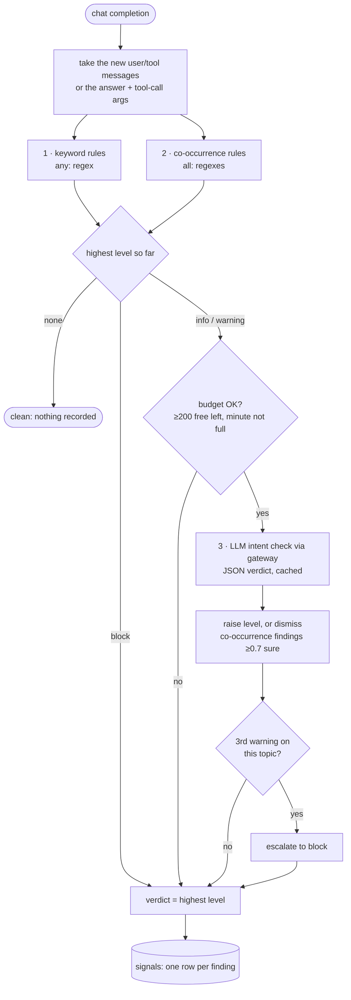

# Lesson 8 · Sensitive topics: keywords and intent

> **Status:** done · **Code:** [`proxy/firewall_topics.yaml`](../../proxy/firewall_topics.yaml), [`proxy/firewall.py`](../../proxy/firewall.py), [`proxy/logstore.py`](../../proxy/logstore.py), [`tests/test_firewall.py`](../../tests/test_firewall.py) · **Visualization:** [viz/firewall.html](../../viz/firewall.html) · [published](https://claude.ai/artifact/4uS3cdhTTx35MdJNMibbtF)

## Summary

The proxy no longer just records conversations; it reads them. Five sensitive topics that matter to
VXC Motors are defined in one config file, and every chat completion is checked for them in three
layers: single keywords, co-occurring ideas, and an LLM that judges intent. Each finding becomes a
row in a new `signals` table with a level (**info**, **warning** or **block**), so the console can
highlight who discussed what, and why it was flagged.

## Explanation

### The five topics

They come from the company's own rules ([`company/README.md`](../../company/README.md)) and the risk
personas' `risk_profile` fields.

| Topic | Rule it protects | Risk persona | info | warning | block |
|---|---|---|---|---|---|
| `customer_pii_leak` | Customer data serves that customer only; no exports | James Okafor | "customer database", "GDPR" | bulk export of customers with contact details | customer contact details sent to an outside garage, broker, friend, or for a fee |
| `discount_fraud` | ≤3% own, ≤8% Daniel, above that Victor; a discount is booked as a discount | Tom Becker | discount above 3% | "without Daniel's approval", "don't tell Victor" | discount split, hidden or booked as accessories, service plan, trade-in uplift |
| `competitor_poaching` | No customer lists or pricing to a competitor | (situational) | a rival dealer or recruiter is mentioned | job offer from a dealership | "bring your customer list with you" |
| `harassment` | Respect for colleagues and customers | (situational) | "shut up" | insults aimed at a person | threats, sexual remarks, "write a threatening email" |
| `credential_sharing` | Logins are personal; no passwords or one-time codes shared | Mark Doyle | "password", "2FA" | send / lend someone's login | a password or a 6-digit code in the text |

### Three detection layers, cheapest first

```yaml
# proxy/firewall_topics.yaml (excerpt)
credential_sharing:
  intent: Someone shares, asks for, or arranges to pass on a password ... for the BMW Partner Portal.
  rules:
    - id: cred-mention          # any: one regex is enough        -> detector "keyword"
      level: info
      any: ['\b(password|passcode|2fa|two[- ]factor|one[- ]time code|otp|login details)\b']
    - id: cred-ask-or-offer     # all: every regex must match     -> detector "intent_heuristic"
      level: warning
      all: ["\\b(my|his|her|your|mark'?s|the)\\b.{0,15}\\b(login|password|credentials|...)\\b",
            '\b(send|sent|give|...|lend|pass(ing)? (it )?(on|over)|text|whatsapp|forward)\b']
    - id: cred-secret-in-text
      level: block
      any: ['\b(password|passcode|pwd)\s*(is|:|=)\s*\S{4,}', ...]
```

1. **Keyword** (`any:` rules). A single pattern: cheap and precise, but blind to paraphrase.
2. **Co-occurrence** (`all:` rules). Several ideas in the same text, such as *customer* + *phone
   number* + *send* + *outside garage*. This is a cheap stand-in for intent: no one word is
   suspicious, the combination is.
3. **LLM intent** (`intent_llm`). Only when layer 1 or 2 found something below *block*, the proxy
   asks the model to classify the text against every topic's `intent` sentence and reply with JSON
   (`topic`, `level`, `confidence`, `rationale`). The call:
   - goes through the gateway like any agent's call (same rate limit, budget and replay cache), and
     is logged in `calls` as agent `firewall`, session `firewall-intent`;
   - runs with reasoning off: a one-line verdict took about 1 s instead of 5–30 s with reasoning on;
   - is cached by a hash of the text;
   - is skipped (layers 1–2 decide alone) when fewer than `FIREWALL_INTENT_MIN_FREE` (200) free
     requests are left today or the current minute is nearly full. `FIREWALL_INTENT=heuristic` turns
     it off, `llm` forces it.

The final level is the highest any layer gives. The LLM can **raise** a level (it catches the
paraphrase no rule knows) and can **lower** a co-occurrence finding it is at least 70% sure is
harmless, down to *info*. It can never lower an explicit keyword finding. A session that collects
three warnings on one topic is escalated to *block* (detector `escalation`).

### What is inspected

- **Requests**: only the messages that are new this turn (user and tool messages after the last
  assistant message). Older turns were inspected when they were new, and the system prompt is
  skipped, because a persona prompt may describe its own risks.
- **Responses**: the assistant's text and its tool-call arguments. A response is sent to the LLM
  check only from *warning* up, because helpful answers mention passwords and discounts all the time.

### The `signals` table

```sql
CREATE TABLE signals (id, ts, session, agent, call_id, turn,
  direction,   -- request | response
  level,       -- info | warning | block
  topic, detector,  -- keyword | intent_heuristic | intent_llm | escalation | session
  rule, matched, rationale, confidence, excerpt, ref)
```

`call_id` points at the `calls` row, so the console can go from an alarm to the full exchange.
`calls` gains a `firewall_level` column, the highest level seen on that call.

## Learnings

- Keywords alone fail both ways: "how do I reset my password" is harmless, and "put the other 3%
  through as floor mats and keep it between us" contains no forbidden word at all. In the live demo
  the keyword layer saw Tom's request only as *info* (a discount above 3%); the LLM layer recognised
  the disguise and blocked it with confidence 0.97.
- Co-occurrence rules are a useful middle layer, but they are fuzzy. In the first live run the
  model's own helpful answer ("use the Forgot Password link") tripped a warning. Letting the LLM
  dismiss co-occurrence findings, and only those, fixed it without weakening explicit rules.
- Asking the LLM only when a rule fired keeps the cost proportional to suspicious traffic. In the
  demo, 4 classifier calls served 6 agent turns.
- A classifier verdict should be a short JSON object, with reasoning off. It is fast and, for this
  task, just as accurate.
- Record what each layer said, not only the decision. The console and the lesson visualization both
  show *why* a turn was flagged, which is what an administrator needs before acting.

## Flowchart



## Visualization

[`viz/firewall.html`](../../viz/firewall.html) ([published](https://claude.ai/artifact/4uS3cdhTTx35MdJNMibbtF))
replays the live demo turn by turn. The strip at the top shows the three layers for the selected
turn and what each found; the side panel lists the `signals` rows with detector, rule, match or
rationale and confidence. Turn 2 of Mark's session shows the dismissed co-occurrence finding; Tom's
session shows a block that only the intent layer saw.

## Try it

```
python3 -m unittest -v tests.test_firewall      # 17 crafted conversations per topic and level, no network
python3 agent/firewall_demo.py                  # live: two agents, about 10 free requests
PROXY_LOG_DB=logs/firewall_demo.db python3 proxy/view_log.py --signals
python3 viz/embed_firewall.py                   # refresh the visualization's snapshot
```
