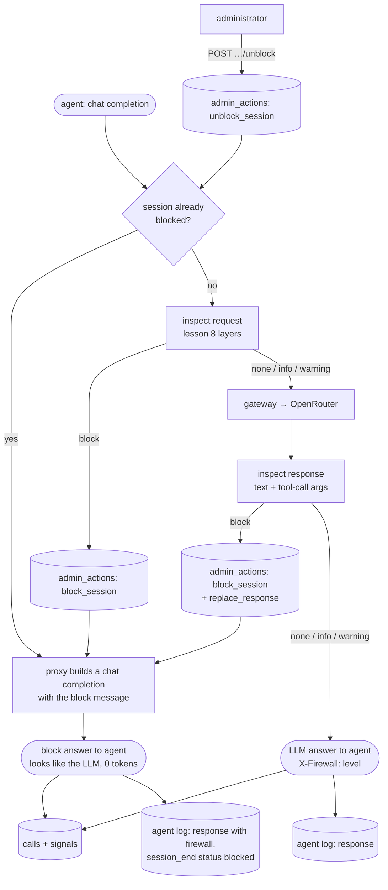

# Lesson 9 · Proxy firewall: answering in the LLM's place

> **Status:** done · **Code:** [`proxy/proxy.py`](../../proxy/proxy.py), [`proxy/firewall.py`](../../proxy/firewall.py), [`llm/agentlog.py`](../../llm/agentlog.py), [`agent/firewall_demo.py`](../../agent/firewall_demo.py), [`tests/test_firewall.py`](../../tests/test_firewall.py) · **Visualization:** [viz/firewall.html](../../viz/firewall.html) · [published](https://claude.ai/artifact/4uS3cdhTTx35MdJNMibbtF)

## Summary

Lesson 8 taught the proxy to recognise sensitive conversations. This lesson lets it act. On a
*block* the proxy does not forward the request: it answers the agent itself, with an ordinary chat
completion saying the conversation was blocked by policy, and closes the session so every later
request in it gets the same answer. Every automatic block and every administrator decision goes into
an `admin_actions` table, and each agent now keeps its own log, so a blocked session can be seen
from both sides.

## Explanation

### Where the firewall sits

The proxy already sees every full request and response, because it does not stream: it receives the
whole request, sends it on, and returns the whole answer. That makes deep session inspection
possible: the firewall reads the complete message before deciding.

```python
# proxy.py, Handler._forward (simplified)
d = FIREWALL.inspect_request(agent, session, req)          # lesson 8 detection, plus session state
if d.blocked:
    status, headers, data = FIREWALL.block_completion(req, d)   # nothing goes upstream
else:
    status, headers, data, meta = GATEWAY.chat(path, body, headers)
    r = FIREWALL.inspect_response(agent, session, req, json.loads(data))
    if r.blocked:
        status, headers, data = FIREWALL.block_completion(req, r)   # LLM answer withheld
call_id = log_call(...)                    # calls row, route = firewall | firewall-response
FIREWALL.commit(d, call_id)                # signals + admin_actions rows
```

### Levels and what each does

| Level | Request | Response | Recorded |
|---|---|---|---|
| none | forwarded | returned | nothing |
| info | forwarded | returned | `signals` row |
| warning | forwarded | returned | `signals` row; the third warning on one topic in a session becomes a block |
| block | **not forwarded**; the proxy answers | **replaced** with the block answer | `signals` row, `admin_actions` `block_session` (+ `replace_response`) |

### The block answer looks like the LLM

```json
{"id": "gen-…", "object": "chat.completion", "model": "nvidia/nemotron-3.5-super-vl:free",
 "choices": [{"index": 0, "finish_reason": "stop", "message": {"role": "assistant", "content":
   "I'm sorry, but I can't continue with this conversation. It has been blocked under the VXC Motors
    acceptable-use policy (Credential sharing): Portal and system logins are personal; passwords and
    one-time codes are never shared. This session is now closed and the IT administrator has been
    notified. Reference: FW-2F6073A2."}}],
 "usage": {"prompt_tokens": 0, "completion_tokens": 0, "total_tokens": 0}}
```

Same shape, same model name, status 200, so the agent's SDK parses it like any answer and the agent
loop ends normally (no tool calls means a final answer). If the agent asked for a stream, the same
text is sent as server-sent events. The text comes from `block_message` in the topics file, with the
topic's policy sentence and a reference the administrator can look up.

The one tell is an `X-Firewall: block; topic=…; ref=…` response header (`info` / `warning` on
flagged calls). It is on by default because the demo and the agent log use it; a deployment that
wants the block to be indistinguishable sets `FIREWALL_DISCLOSE=off`.

### Dropping the session upstream

- A request-side block never opens a connection to OpenRouter: there is nothing to drop and nothing
  spent (0 tokens, about 0 ms once the session is known to be blocked).
- A response-side block happens after the model answered (the proxy does not stream, so the answer
  is complete). The answer is withheld: the tool call it contained, for example an email with a
  password to a broker, never reaches the agent and is never executed.
- The session stays blocked: `inspect_request` checks session state first, and every later request
  in that session is answered by the proxy (detector `session`). Blocks survive a proxy restart,
  because the state is rebuilt from `admin_actions`.

### The `admin_actions` table and the admin endpoints

```sql
CREATE TABLE admin_actions (id, ts,
  actor,    -- 'firewall' or the administrator's name
  action,   -- block_session | unblock_session | replace_response | note
  session, agent, topic, reason, ref, call_id)
```

Signals say what was *seen*; actions say what was *done*, by whom and why. The proxy exposes:

```
GET  /v1/firewall/status                         topics, blocked sessions, counters
POST /v1/firewall/sessions/<session>/block       {"actor": "victor", "reason": "..."}
POST /v1/firewall/sessions/<session>/unblock     reopens the session, resets its warning count
POST /v1/firewall/sessions/<session>/note
```

Set `FIREWALL_ADMIN_TOKEN` to require an `X-Admin-Token` header. The admin console (lesson 7) is
built on these tables and endpoints.

### The agent's own log

`llm/agentlog.py` writes one JSON line per event to `logs/agents/<agent_id>.jsonl`:
`session_start`, `request` (only new messages), `response` (text, tool calls, usage, and the parsed
`X-Firewall` header), `tool`, `error`, `session_end` (status `blocked` if a block was received).

```python
from llm import AgentLog, chat, make_client
client, session = make_client("parts-mark", role="parts")
log = AgentLog("parts-mark", session, role="parts")
resp = chat(client, messages, log=log)   # records request and answer
if log.blocked: ...                      # {"level": "block", "topic": "credential_sharing", "ref": "FW-…"}
```

`agent/agent.py` uses it too, and the multi-agent runner can reuse it as is. The two logs answer
different questions: the proxy log says *why* a session was blocked; the agent log shows *what the
agent experienced*, which is a polite refusal that reads like any model answer.

## Learnings

- Answering in the LLM's place is the cleanest way to block an agent. An HTTP error would make the
  agent's SDK raise, and many agents would retry. A normal answer ends the turn gracefully and the
  agent can even report the refusal to its user.
- Inspect both directions. The request shows what a person asked for; the response shows what the
  agent was about to *do* (a tool call with a password in it). Blocking the response stops the
  action even when the request looked innocent.
- A blocked session must stay blocked. Otherwise the agent can simply rephrase. In the demo, Mark's
  agent tried again with the actual password and then with a harmless question; both were answered
  by the proxy without reaching the model.
- Keep enforcement state in the log, not only in memory, so a restart cannot reopen a session, and
  every unblock has a name and a reason attached.
- The live demo blocked earlier than expected: the intent check blocked "send my portal login to the
  broker" (turn 3), before the turn that contained the password (turn 4). Intent is the right
  trigger; the password turn would have been blocked by a keyword anyway.

## Flowchart



## Visualization

[`viz/firewall.html`](../../viz/firewall.html) ([published](https://claude.ai/artifact/4uS3cdhTTx35MdJNMibbtF))
is a recorded live run of [`agent/firewall_demo.py`](../../agent/firewall_demo.py). Pick a session,
then a turn: the strip shows the inspection path and who answered (LLM or proxy), and the side panel
puts the agent's own log entry next to the proxy's record of the same answer. Refresh the snapshot
with `python3 viz/embed_firewall.py`.

## Try it

```
python3 -m unittest -v tests.test_firewall
python3 agent/firewall_demo.py
PROXY_LOG_DB=logs/firewall_demo.db python3 proxy/view_log.py --signals
cat logs/agents/parts-mark.jsonl

# by hand, with a proxy running:
curl -s http://127.0.0.1:8080/v1/firewall/status
curl -s -X POST http://127.0.0.1:8080/v1/firewall/sessions/<session>/unblock -d '{"actor":"victor","reason":"reviewed"}'
```
