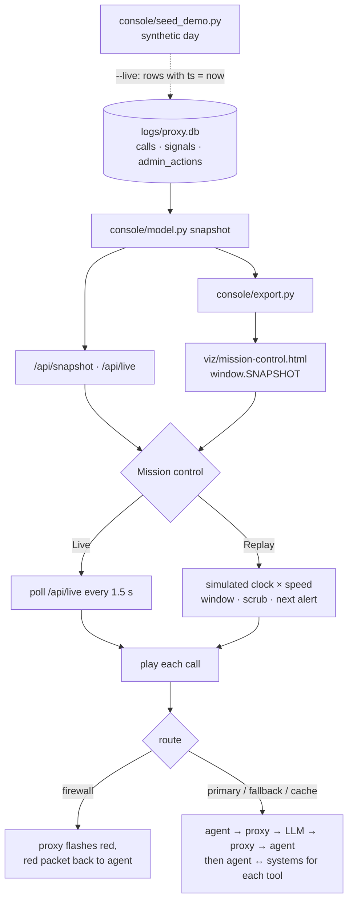

# Lesson 10 · Mission control, replay and demo

> **Status:** done · **Code:** [`console/web/mission.html`](../../console/web/mission.html), [`console/server.py`](../../console/server.py) (`/api/live`), [`console/export.py`](../../console/export.py), [`console/seed_demo.py`](../../console/seed_demo.py) · **Visualization:** [viz/mission-control.html](../../viz/mission-control.html) · [published](https://claude.ai/artifact/WbX69o9po7W8Dx9Pjx1iT4)

## Summary

Most of this system works where nobody can see it: agents call the LLM, the proxy logs and inspects,
the firewall decides. Mission control makes that visible. Every agent is a node; each LLM call is
drawn as a packet travelling agent → proxy → LLM and back, each tool call as a packet to the business
system it touches, and every firewall block flashes red at the proxy and on the agent. It runs live
over the proxy log, replays any time window at up to 900× speed, and exports to a self-contained page
that can be published and shown to anyone.

## Explanation

**The map.** Three kinds of node, laid out so the flow reads left to right:

| Node | Where | Comes from |
|---|---|---|
| 12 agents (avatars) | down the left, grouped by department | personas, plus any agent id seen in the log |
| Proxy (firewall · gateway · log) and LLM | centre and right | fixed |
| 7 business systems (CRM, DMS, Workshop, Parts, Finance, Mail, BMW portal) | along the bottom | tool names: agents call tools `<system>_<verb>`, so `crm_find_customer` → CRM, `bmw_portal_order_parts` → BMW portal |

**What one call looks like.** For each `calls` row, `playCall()` sends a blue packet agent → proxy,
then:

- `route = firewall` (blocked before reaching the LLM): the proxy ring turns red and a red packet goes
  straight back to the agent. Nothing goes to the LLM, which is exactly what lesson 9 promised.
- otherwise: purple proxy → LLM, the LLM glows for the call's `duration_ms` (compressed by the replay
  speed, clamped so it stays visible), green LLM → proxy → agent, then amber packets to and from
  each system whose tool the LLM asked for.

Signals arrive in the event feed; warnings and blocks also raise a banner ("FIREWALL BLOCK · Tom
Becker · Discount fraud · FW-…") and make the agent's node pulse. Admin actions (the firewall's own
`block_session`, an administrator's note) are listed as they happen.

**Replay.** The page keeps a simulated clock. Each frame it advances by real time × speed and plays
every call, signal and action whose `ts` it has passed. The scrub bar under the controls is a
histogram of calls per minute with warnings (amber) and blocks (red) as ticks; drag it to jump,
set **From / to** to replay a window, or press **Next alert** to jump just before the next warning
or block. Quiet stretches longer than 90 simulated seconds are skipped, so a nine-hour day plays in
about four minutes at 120×.

**Live.** With the console server running, **Live** polls `GET /api/live?call=N&signal=N&action=N`
every 1.5 s and animates whatever was written since. To demo live mode without spending LLM
requests, play the synthetic day into the log in real time:

```
python3 console/seed_demo.py --live --speed 30 --out logs/demo.db   # appends rows with ts = now
python3 console/server.py --demo                                     # open /mission, press Live
```

**Static export.** `console/export.py` writes the snapshot into the page as `window.SNAPSHOT`
(`</` escaped so data cannot close the script tag, the provider key redacted again). The exported page
starts in replay mode and needs no server; `--since/--until` limit it to a window of the log.

**The synthetic day.** Until the multi-agent runner (lesson 6) produces real days,
[`console/seed_demo.py`](../../console/seed_demo.py) writes a hand-written workday at VXC Motors in
exactly the proxy's table shapes: 31 sessions across all 12 people, tool calls into every system,
and the five sensitive topics. The three risk personas drift (Tom Becker backdates a promotion,
James Okafor tries to send customer data to his Gmail, Mark Doyle emails his BMW portal password),
and two situational topics are injected (Daniel Reed's demeaning message about Sofia, and Sofia
being asked for leads by a competitor's recruiter). Blocked replies use the firewall's own wording
from `proxy/firewall_topics.yaml`. No LLM request is made.

## Learnings

- **Compress time, not motion.** Replaying at 120× would make a 3-second LLM call last 25 ms. The
  hops are animated in fixed real time and only the LLM's thinking time scales with speed; the
  simulated clock still decides *when* each call starts.
- **Skip the silence.** Real logs have long gaps. Jumping over quiet stretches keeps a demo watchable
  without changing the order or the timing of anything that happened.
- **One snapshot for everything.** Mission control reads the same model as the console, so the
  "4 blocks" on the map are the same 4 rows the console lists.
- **Name tools after systems.** A naming convention (`<system>_<verb>`) is all mission control needs
  to draw agent → system traffic; the tool calls are already in the logged responses.
- **Tool execution is invisible to the proxy.** The proxy sees the LLM *ask* for a tool and, on the
  next request, the tool's *result*. The amber packets are drawn from that pair; the call itself
  happens inside the agent.

## Flowchart



## Visualization

[`viz/mission-control.html`](../../viz/mission-control.html) ([published](https://claude.ai/artifact/WbX69o9po7W8Dx9Pjx1iT4)) replays
the synthetic VXC Motors day. It starts playing at 120×; press **Next alert** to jump to Tom Becker's
discount request at 10:40, the first warning that becomes a block. The companion console,
[`viz/console.html`](../../viz/console.html) ([published](https://claude.ai/artifact/4qKXJBDNUJXZNcUJKNvipu)), is where an alert is
read in full.

### Demo script (five minutes)

1. Open mission control. Let the morning run for 20 seconds: reception, the GM's brief, a service
   check-in, each call visible as a packet to the LLM and out to the systems.
2. Press **Next alert** twice. Tom asks to split an 11% discount (warning, amber), then to backdate a
   promotion: the proxy turns red and answers him itself. Nothing reaches the LLM.
3. Keep playing through 11:15–12:10: James (customer list to Gmail), Daniel (warning only: the
   agent rewrites his message), Sofia (competitor), Mark (password). Point at the counters.
4. Switch to the console. Click Mark Doyle's block in the alert rail: the password and the one-time
   code are highlighted in his message, the firewall's reply is shown in red, and the IT admin's note
   ("password reset") sits in the session's history.
5. Go up to **Sales**: the department summary already says what happened, without opening a
   conversation. That is the point of the console.

## Try it

```
python3 console/server.py --demo                     # console :8090, mission control at /mission
python3 console/seed_demo.py --live --speed 30       # in a second terminal, then press Live
python3 console/export.py --demo                     # bake both pages into viz/
python3 console/export.py logs/proxy.db --since 2026-10-28T08:00 --until 2026-10-28T12:00
```
