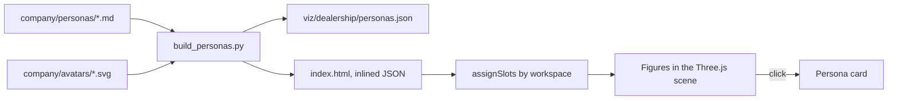

# Side lesson · Walkable 3D dealership

> **Status:** done · **Code:** `viz/dealership/` · **Visualization:** [viz/dealership/index.html](../../viz/dealership/index.html) · [published](https://claude.ai/artifact/UVbFvg1v9YcCVqYUzNCivm)

## Summary

A single HTML file renders the VXC Motors site in 3D: showroom, reception, customer lounge, service
reception, a six-bay workshop, the parts store and the offices. You walk through it in first person,
and clicking any of the 12 staff opens the persona that their AI agent plays. The persona data comes
straight from `company/personas/*.md`, so the model always shows the same people the agents act as.

## Explanation

**Renderer choice.** Three.js (r160, loaded as an ES module from jsDelivr). It is the smallest
dependency that gives real-time WebGL, shadows, raycast picking and a camera we control by hand.
Babylon.js would also work but ships a much larger runtime; A-Frame adds an entity layer we don't
need. No models or textures are downloaded: every wall, car and person is built from boxes, cylinders
and spheres, and the floor tiles, signs and name tags are drawn on `<canvas>` at load time. That keeps
the page a single file that can be published as an artifact.

**Floor plan.** The building is 60 m × 40 m, built from one `wall(x1, z1, x2, z2, {gaps, glass})`
helper. A gap is `[from, to, lintelHeight, sillHeight]`, so the same call makes doorways, the
workshop roller door and the parts-counter hatch (a gap with a 1 m sill). Every solid piece pushes an
axis-aligned box into `colliders`, which serves both collision and the 2D plan.

```
 street (z = -46) · forecourt parking · glass facade with main and service entrances
 ┌──────────── showroom ─────────────┬──── service reception ────┐  z = -20
 │ lounge   turntable i5   reception │  advisors' counter        │
 │ sales desks          sales mgr    │            service mgr    │
 ├────────────────── corridor ───────┴───────────────────────────┤  z = 0..4
 │ back office │ parts store │ workshop: 6 bays, roller door ▶   │
 │ GM office   │  counter ▶  │                                   │  z = 20
 └─────────────┴─────────────┴───────────────────────────────────┘
 x = -30                                                     x = 30
```

**People.** Each persona has a `workspace` key (`gm-office`, `reception`, `back-office`,
`sales-office`, `showroom`, `service-desk`, `workshop`, `parts-counter`). `SLOTS` maps each workspace
to one or more standing positions with a point to look at; managers claim the slot with a
`hint: /manager/i` first, everyone else fills the rest in order, and anyone without a free slot falls
back to their department's area, then to a spare spot in the corridor. Seven customers are scene
extras placed opposite staff, so you see sales and service conversations in progress.

Figures are generated from the persona id: a hash picks skin tone, hair colour and length, height,
and the department picks the outfit (navy overalls for the workshop, teal polos for service, and so
on). Each figure carries an invisible cylinder as a generous hit target; a `Raycaster` against those
cylinders powers hover and click.

**Persona data flow.**

```python
# viz/dealership/build_personas.py
meta, body = parse_frontmatter(md)       # YAML frontmatter + Markdown body
meta["profile_md"] = body                # rendered on the card
meta["avatar"] = avatar_uri(meta["id"])  # company/avatars/<id>.svg as a data: URI
```

The script writes `personas.json` and also inlines the same JSON into the
`<script id="personas-data">` block in `index.html`. Opened from disk or published as an artifact,
the page uses the inlined copy; served over http, it fetches `personas.json` and prefers it.

**Controls.** `W/A/S/D` walk and strafe, `←/→` (or `Q/E`) turn, `Shift` hurries, mouse drag looks
around. On touch screens a six-button pad appears. `M` opens the full floor plan, `B` switches to a
bird's-eye cutaway (the ceiling is hidden, drag to orbit, scroll to zoom). The minimap and plan are
both clickable to walk there, and the People list jumps you to anyone.

## Learnings

- Draw the plan the way a visitor sees it. Facing the building from the street, world +x is on your
  left, so the plan mirrors x; otherwise the minimap and the 3D view disagree.
- One collider list for walls, furniture and cars is enough for a walkable scene. Moving along x and
  z separately gives free wall-sliding.
- A car on a lift is not an obstacle but is a bad place to stand: "Walk to" picks a spot 2.4 m from
  the person on the side you came from, and skips spots under a raised car.
- Generated geometry plus canvas textures keeps the file at about 125 KB with all 12 personas and
  avatars embedded.
- The persona files carry a `risk_profile` that later lessons use for sensitive-topic detection. The
  card deliberately hides it so the demo doesn't give the plot away.

## Flowchart



## Visualization

[viz/dealership/index.html](../../viz/dealership/index.html) in the repo, and the
[published artifact](https://claude.ai/artifact/UVbFvg1v9YcCVqYUzNCivm). Start on the forecourt, walk
through the main entrance, and use the dock buttons to jump between Showroom, Service, Workshop,
Parts and Offices.

## Try it

```
python3 viz/dealership/build_personas.py      # after any persona change
python3 -m http.server -d viz/dealership 8000 # then open http://localhost:8000
```

Opening `viz/dealership/index.html` directly also works, since the personas are inlined. It needs
internet access for Three.js and the fonts.
