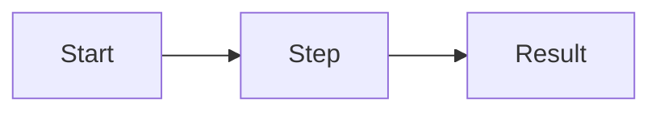

# Lesson N · Title

> **Status:** planned | in progress | done · **Code:** `path/to/files` · **Visualization:** [viz/name.html](../../viz/name.html) · [published](https://claude.ai/artifact/…)

## Summary

Two or three sentences: what this lesson adds and why it matters.

## Explanation

How it works, step by step, with the concrete names used in the code (env vars, tables, headers,
functions). Show the smallest code excerpt that makes the idea click.

## Learnings

- What surprised us, what broke, what a reader should remember.
- Trade-offs that were chosen and why.

## Flowchart



## Visualization

What the page shows and how to use it. Link the repo file and the published artifact.

## Try it

```
commands to reproduce
```
