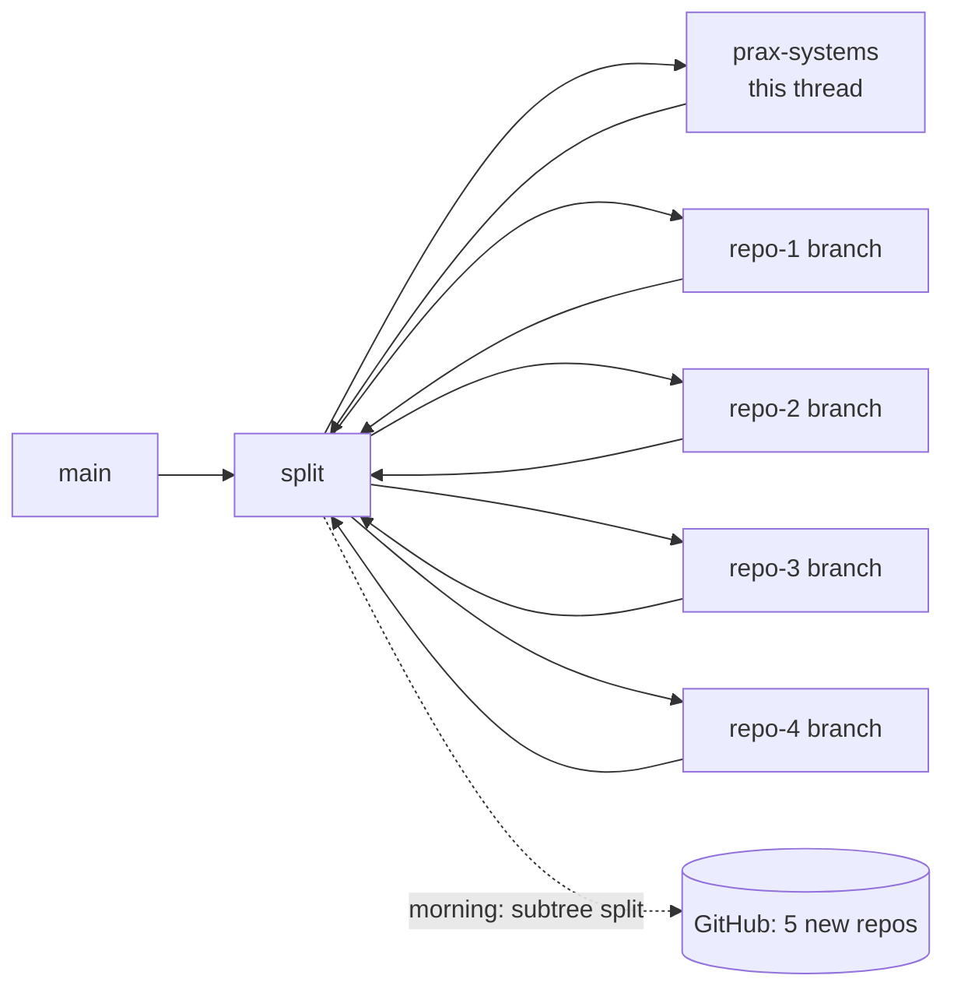

# Master plan · splitting agent-session-inspector into a Prax Systems ecosystem

Started 2026-10-30 21:12 UTC, built autonomously overnight; review on 2026-10-31.

## The goal (user's brief, condensed)
Split the learning project into small repos that strangers can clone, understand, run and
**rebuild**. Every repo ships code **and** goal, specification and rebuild prompts (hard rule), a
roadmap, a README, demo data and animated explainers. A new methodology, **Prax Systems**, defines
how. Nothing is pushed to new GitHub repos until the user creates them; until then everything lives
in `repos/` on branch `split` of this repository.

## Top-level accomplishments

| # | Repo | What it delivers | Owner thread | Status |
|---|---|---|---|---|
| 0 | [`prax-systems`](prax-systems/) | Method (6 layers, workflow, rules, levels), templates, stdlib checker, worked example, animated explainer | Create Prax Systems methodology and master plan | 🔜 v0.1 done, explainer in progress |
| 1 | [`llm-proxy-log`](llm-proxy-log/) | OpenAI-compatible proxy holding the real key; logs every exchange to SQLite (K-log-schema@1); user identity via `X-Agent-User` (K-agent-headers@1); gateway (rate limit, fallback, spend cap); small dashboard; demo team of 3–4 agents (dev, support, sales…) with recorded logs + live traffic script | repo-1 thread | ⏳ skeleton |
| 2 | [`llm-proxy-firewall`](llm-proxy-firewall/) | Standalone copy of repo 1 **plus** the session firewall: info/warning/block, intent check, proxy answers as the LLM on block, signals + admin_actions (K-log-schema@2); small dashboard with firewall view; demo team whose recorded day includes incidents | repo-2 thread | ⏳ skeleton |
| 3 | [`vxc-motors-sim`](vxc-motors-sim/) | VXC Motors BMW dealership: 12 employees **are agents** whose only channel is the LLM; enterprise apps **are tools** backed by small real local HTTP + DuckDB services; email and chat are tool calls delivered into real mailboxes/channels other agents read next turn; judgment tools (BMW portal) backed by an agent through the proxy; doc of what is behind each tool | repo-3 thread | ⏳ skeleton |
| 4 | [`llm-session-console`](llm-session-console/) | Local web app over the log DB: drill-down global → user → day/week charts (messages, sessions, tokens) → sessions → messages → firewall events; one Three.js 3D "galaxy" view (users → sessions → messages, click to drill); works on @1 and @2 logs | repo-4 thread | ⏳ skeleton |
| — | [`CONTRACTS.md`](CONTRACTS.md) | Shared contracts between the repos, one owner each | this thread | ✅ v1 proposal |
| — | [`PUBLISHING.md`](PUBLISHING.md) | How the user creates each GitHub repo and pushes each folder as a standalone repo | this thread | ⏳ |
| — | [`MORNING_REPORT.md`](MORNING_REPORT.md) | Status, decisions, links to every explainer, what needs the user | this thread | ⏳ |

Status key: ✅ done · 🔜 in progress · ⏳ planned.

## Definition of done for each repo (Prax Systems Silver)

- [ ] `prax.yaml`, README (60-second offline quickstart), GOAL, SPEC (R-ids + contracts), ARCHITECTURE, **PROMPTS (P-01…, P-REBUILD, P-VERIFY)**, ROADMAP, DECISIONS
- [ ] `demo/data/` recorded data, `demo/DEMO.md`, live traffic generator
- [ ] `explainers/index.html` animated (what, goal/problem, how it works, replicate) and published as an artifact
- [ ] Offline tests citing R-ids, passing
- [ ] `python3 ../prax-systems/tools/prax_check.py . --level silver` passes
- [ ] Runs standalone: no imports from outside its own folder; own `requirements.txt` and `LICENSE`

## How the work is organised

- **Integration branch:** `split` (off `main` at PR #5). `main` is untouched.
- Each thread works in its own folder under `repos/` on its own branch off `split` and merges back
  into `split`. Folders do not import from each other or from the root project; code is **copied**
  from the root (`proxy/`, `llm/`, `console/`, `systems/`, `runner/`, `dashboard/`) and trimmed.
- Shared surface = [`CONTRACTS.md`](CONTRACTS.md). Repo 4 tests against the demo DBs of repos 1 and 2.

## Build order and dependencies
1. `prax-systems` v0 + CONTRACTS (this thread, first) → everyone reads it.
2. Repos 1 and 3 in parallel. Repo 2 starts from repo 1's proxy (or from root `proxy/` directly if
   repo 1 is not ready, keeping K-log-schema@2 ⊇ @1).
3. Repo 4 starts immediately against a synthetic DB in the contract shape, then switches to the demo
   DBs of repos 1/2.
4. This thread: compliance sweep, PUBLISHING.md, MORNING_REPORT.md.

## Budget (user decision 12a)
Free model `nvidia/nemotron-3.5-super-vl:free` first, **≤ 15 req/min across all threads**; GLM
`z-ai/glm-5.3-flash` fallback; paid spend target ≤ $3, hard ceiling $10 only if really needed. All
LLM calls go through the proxy gateway. Recorded demo days should be small (tens to a few hundred
calls).

## Decisions taken (summary; details in each repo's DECISIONS.md)
| # | Decision | By |
|---|---|---|
| 1 | Folders in `repos/` on branch `split`, pushed; user guided to publish each as a standalone repo | user (1a) |
| 2 | Names `llm-proxy-log`, `llm-proxy-firewall`, `vxc-motors-sim`, `llm-session-console`, `prax-systems` (OK for now) | user (2a) |
| 3 | Methodology "Prax Systems" in its own folder; all repos follow it | user (3a) |
| 4 | Repo 2 = standalone copy of repo 1 + firewall | user (4a) |
| 5 | Small dashboard in 1 and 2; rich drill-down only in 4 | user (5a) |
| 6 | Demo for 1/2: generic 3–4 agent team, recorded logs + live script | user (6a) |
| 7 | User identity: `X-Agent-User` (+ dept/session), fallback hashed API key | user (7a) |
| 8 | Console: 2D drill-down main UI + one Three.js galaxy view | user (8a) |
| 9 | VXC tools: small real local services; mail/chat delivered to real mailboxes/channels; judgment tools backed by agents through the proxy | user (9a, 10a) |
| 10 | Explainers: self-contained HTML/SVG per repo, published as artifacts | user (11a) |
| 11 | Six-layer model, R-ids, P-REBUILD/P-VERIFY, versioned contracts, Bronze/Silver/Gold + checker | agent, autonomous (review) |
| 12 | `calls.user` and `calls.dept` columns added in K-log-schema@1 (today's schema only has `agent` + `labels`) | agent, autonomous (review) |
