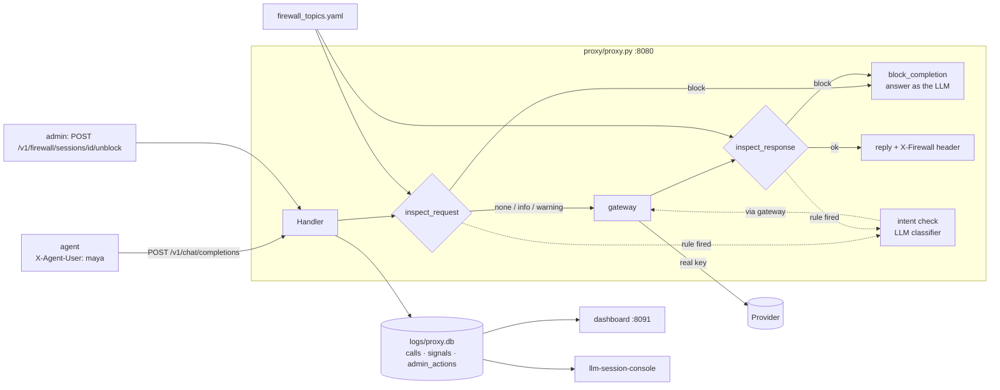

# Architecture · llm-proxy-firewall

## Component diagram

### The four detection layers (cheapest first)
| Layer | Detector | What it does | Can it be overruled? |
|---|---|---|---|
| 1 | `keyword` | an `any:` rule: one regex matches | request side: never; response side: lowered if the LLM sees a refusal or report |
| 2 | `intent_heuristic` | an `all:` rule: several ideas co-occur ("customers" + "emails" + "my gmail") | the LLM can lower it to info when confident it is harmless |
| 3 | `intent_llm` | the classifier reads topic and stance; runs only when layer 1–2 fired | capped by the topic's `llm_max_level` |
| 4 | `grounding` | optional: "the manager approved it" must match an approval record in tool results | no |
Plus `escalation` (3 warnings on one topic in one session) and `session` (already blocked).

### One blocked request, step by step
1. Maya's dev-assistant sends "The staging IMAP password is Leaf!2026dev…".
2. `identity()` resolves user maya, session; `inspect_request` scans the new user message.
3. Rule `cred-secret-in-text` (keyword, `hard`) fires at block. The intent check is asked anyway
   (its verdict is logged) but cannot lower a hard rule.
4. The session is marked blocked; `block_completion` builds a normal chat completion with the block
   message and `FW-…` reference. The provider is never called.
5. One `calls` row (route `firewall`, firewall_level `block`), the signals, and an `admin_actions`
   `block_session` row are written with user `maya`.
6. Every later request of that session gets the same answer until an admin unblocks it.

## Runtime
| Process | Command | Port / file | Env |
|---|---|---|---|
| proxy | `python3 proxy/proxy.py` | :8080, `logs/proxy.db`, `logs/gateway.db` | `OPENROUTER_API_KEY`, `PROXY_*`, `GATEWAY_*`, `FIREWALL_*` |
| dashboard | `python3 dashboard/server.py [--demo]` | :8091 | `PROXY_LOG_DB` |
| fake LLM | started by `demo/run.py --offline` | :8099 | — |
| demo team | `demo/run.py` / `demo/team.py` | client of :8080 | `LLM_*` |

## Data model
K-log-schema@2 in SPEC.md §3. In memory the firewall keeps: blocked sessions (rebuilt from
`admin_actions` at start), warning counts per (session, topic) (reset on restart and on unblock), and
an LRU cache of intent verdicts (2,000 texts).

## Requirement → code map
| R-id | Where |
|---|---|
| R-001…R-043, R-100…R-103 | as in llm-proxy-log (`proxy/proxy.py`, `logstore.py`, `gateway.py`, `dashboard/`, `demo/`) |
| R-201, R-218 | `proxy/firewall.py: load_topics, Firewall.scan`; `proxy/firewall_topics.yaml` |
| R-202, R-203 | `proxy/firewall.py: request_text, response_text` |
| R-204 | `proxy/firewall.py: Firewall._decide` (warning counter) |
| R-205, R-206, R-219 | `proxy/firewall.py: classify, _apply_verdict, _lowerable, _parse_verdict` |
| R-207 | `proxy/firewall.py: _use_llm` |
| R-208 | `proxy/firewall.py: _restore` |
| R-209, R-212, R-214 | `proxy/proxy.py: Handler._forward`; `proxy/firewall.py: block_completion, _settle` |
| R-210 | `proxy/proxy.py: Handler._forward` (X-Firewall, firewall_level) |
| R-211 | `proxy/proxy.py: Handler._firewall_admin`; `proxy/firewall.py: admin` |
| R-213 | `proxy/firewall.py: commit`; `proxy/logstore.py` schema |
| R-215 | `proxy/proxy.py: _intent_llm, _intent_call, _budget_ok` |
| R-216 | `proxy/proxy.py: EXEMPT_AGENTS` |
| R-217 | `proxy/firewall.py: ground` |
| R-230, R-231 | `dashboard/server.py: ROUTES`; `dashboard/static/index.html: renderSignals, openSession` |
| R-242 | `demo/data/demo.db` (built by `demo/recording.py load --redate-days 7 --anchor 2026-10-30`) |

## Extension points
- **Your policy:** copy `proxy/firewall_topics.yaml`, change `organization`, `block_message` and the
  topics; point `FIREWALL_TOPICS` at it. Test new rules with a few crafted lines like `CASES` in
  `tests/test_firewall.py`.
- **Approval claims:** add a `grounding:` section (people names → ids) to check "X approved it" claims
  against approval records in tool results (used by vxc-motors-sim).
- **Another judge:** `FIREWALL_INTENT_MODEL` picks the classifier model; `FIREWALL_INTENT=heuristic`
  turns it off.
- **Alerting:** read new `admin_actions` rows (or poll `GET /v1/firewall/status`) and notify a channel.
