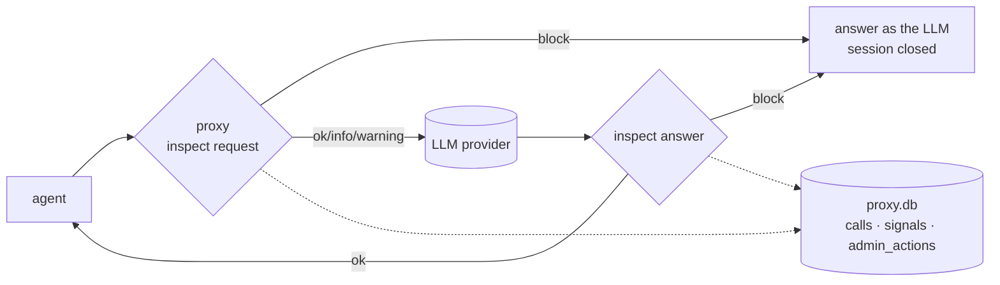

# llm-proxy-firewall

> LLM logging proxy with a policy firewall.

<p align="center"></p>

> [!IMPORTANT]
> **This repo publishes the blueprint, not just the code.** Most projects share only their code.
> This one also ships, in [`blueprint/`](blueprint/), the goal, the full specification, the
> architecture, every design decision and the ordered prompts an LLM followed to build it. Code is
> written by today's models and ages with them; the blueprint does not. When a more capable model
> arrives, anyone can hand it the blueprint, regenerate this project from scratch (in this language
> or another) and prove the result with the same tests and recorded demo data.
> [How to rebuild it ↓](#rebuild-it-from-the-blueprint)

## The problem it solves

Once staff work through AI agents, the agent is where policy gets broken: a customer list pasted
into a chat "for a side project", a password typed in clear text, an insult drafted into an email,
the roadmap sent to a recruiter. The LLM provider sees all of it but enforces none of your rules,
and building checks into every agent does not scale. A log alone only tells you afterwards; it does
not stop the request or alert anyone in time.

llm-proxy-firewall is the logging proxy plus a firewall that reads every request and every answer
against a YAML policy, flags what looks wrong, and blocks a breach before it reaches the provider,
answering the agent in the LLM's place.

**Animated explainer:** [explainers/index.html](explainers/index.html) · [published](https://claude.ai/artifact/9B6TSTeeKKVG2z3yT3fYYN)

## What it is
Everything [llm-proxy-log](../llm-proxy-log/) does (agents change only their base URL; the proxy
holds the key and logs every call to SQLite), plus a firewall. For every chat completion it reads
what the agent sends and what the LLM answers, against a policy written in YAML:

- **info**: noted (someone mentioned passwords);
- **warning**: noted, forwarded, flagged with an `X-Firewall` header (bulk export of customer emails);
- **block**: not forwarded. The agent gets a normal-looking answer saying the session is closed, with
  a reference like `FW-F5588065`, and the session stays closed until an administrator reopens it.

Rules catch the words; an LLM classifier, asked only when a rule fired, judges the intent and who is
doing what (asking, refusing, reporting). Every finding is stored with its reason.

## 60-second quickstart (no API key)
```bash
git clone <this repo> && cd llm-proxy-firewall
python3 dashboard/server.py --demo        # http://127.0.0.1:8091 : a recorded week with incidents
PROXY_LOG_DB=demo/data/demo.db python3 proxy/view_log.py --signals   # the findings in a terminal
```

Fresh traffic offline (fake LLM, rules only):
```bash
pip install -r requirements.txt
python3 demo/run.py --offline && python3 dashboard/server.py
```

## Run it live
```bash
export OPENROUTER_API_KEY=sk-or-...
python3 proxy/proxy.py                    # http://127.0.0.1:8080/v1, firewall on
python3 demo/run.py --live                # the demo team, including 8 risky requests
```
Your own policy: copy `proxy/firewall_topics.yaml`, edit it, `export FIREWALL_TOPICS=my_topics.yaml`.
Reopen a session: `curl -X POST localhost:8080/v1/firewall/sessions/<id>/unblock -d '{"actor":"me","reason":"reviewed"}'`.

## How it works

- Layers, cheapest first: keyword rules, co-occurrence rules, an LLM intent check (only when a rule
  fired), an optional grounding check for "the manager approved it" claims.
- Three warnings on one topic in one session escalate to a block.
- Blocks survive restarts; admins block, unblock and note through HTTP routes.
- Schema K-log-schema@2 = llm-proxy-log's `calls` + `signals` + `admin_actions` ([SPEC.md](blueprint/SPEC.md)).
- Details: [ARCHITECTURE.md](blueprint/ARCHITECTURE.md). Walkthrough: [demo/DEMO.md](demo/DEMO.md).

**What it is not:** a guarantee. Regexes miss paraphrases and an LLM misjudges intent. Treat it as a
tripwire with an audit trail.

## Rebuild it from the blueprint

The code is one rendering of the specification; [`blueprint/`](blueprint/) is the system itself.

| File | What it holds |
|---|---|
| [GOAL.md](blueprint/GOAL.md) | why it exists, who it is for, what success looks like, non-goals |
| [SPEC.md](blueprint/SPEC.md) | the source of truth: components, versioned contracts and numbered requirements (R-…) |
| [ARCHITECTURE.md](blueprint/ARCHITECTURE.md) | how the parts fit, and where each requirement lives in the code |
| [PROMPTS.md](blueprint/PROMPTS.md) | the ordered prompts that built it (P-01…), plus P-REBUILD and P-VERIFY |
| [DECISIONS.md](blueprint/DECISIONS.md) | every design choice, with the alternatives and consequences |
| [ROADMAP.md](blueprint/ROADMAP.md) | milestones done and what comes next |

To regenerate the project, give a coding model the `blueprint/` folder and the **P-REBUILD**
prompt from PROMPTS.md, then run **P-VERIFY**. The tests in `tests/` cite the requirement ids
they prove and `demo/data/` holds recorded traffic, so you can tell whether the rebuild behaves
like this one. The method behind it is [Prax Systems](../prax-systems/README.md).

## Tests
```bash
python3 -m unittest discover -s tests     # offline: fake provider, real proxy processes
python3 tools/prax_check.py . --level silver
```

License: Apache 2.0 (see LICENSE).
