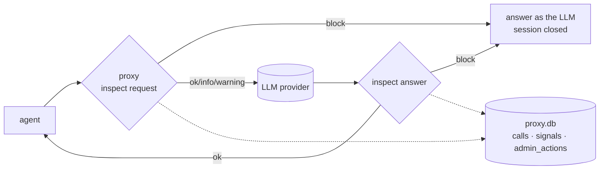

# llm-proxy-firewall

> An OpenAI-compatible LLM proxy that logs every exchange and runs a firewall over every conversation: it flags policy breaches and can close a session by answering in the LLM's place.

**Animated explainer:** [explainers/index.html](explainers/index.html) · [published](https://claude.ai/artifact/9B6TSTeeKKVG2z3yT3fYYN)

## What it is
Everything [llm-proxy-log](../llm-proxy-log/) does (agents change only their base URL; the proxy
holds the key and logs every call to SQLite), plus a firewall. For every chat completion it reads
what the agent sends and what the LLM answers, against a policy written in YAML:

- **info**: noted (someone mentioned passwords);
- **warning**: noted, forwarded, flagged with an `X-Firewall` header (bulk export of customer emails);
- **block**: not forwarded. The agent gets a normal-looking answer saying the session is closed, with
  a reference like `FW-F5588065`, and the session stays closed until an administrator reopens it.

Rules catch the words; an LLM classifier, asked only when a rule fired, judges the intent and who is
doing what (asking, refusing, reporting). Every finding is stored with its reason.

## 60-second quickstart (no API key)
```bash
git clone <this repo> && cd llm-proxy-firewall
python3 dashboard/server.py --demo        # http://127.0.0.1:8091 : a recorded week with incidents
PROXY_LOG_DB=demo/data/demo.db python3 proxy/view_log.py --signals   # the findings in a terminal
```

Fresh traffic offline (fake LLM, rules only):
```bash
pip install -r requirements.txt
python3 demo/run.py --offline && python3 dashboard/server.py
```

## Run it live
```bash
export OPENROUTER_API_KEY=sk-or-...
python3 proxy/proxy.py                    # http://127.0.0.1:8080/v1, firewall on
python3 demo/run.py --live                # the demo team, including 8 risky requests
```
Your own policy: copy `proxy/firewall_topics.yaml`, edit it, `export FIREWALL_TOPICS=my_topics.yaml`.
Reopen a session: `curl -X POST localhost:8080/v1/firewall/sessions/<id>/unblock -d '{"actor":"me","reason":"reviewed"}'`.

## How it works

- Layers, cheapest first: keyword rules, co-occurrence rules, an LLM intent check (only when a rule
  fired), an optional grounding check for "the manager approved it" claims.
- Three warnings on one topic in one session escalate to a block.
- Blocks survive restarts; admins block, unblock and note through HTTP routes.
- Schema K-log-schema@2 = llm-proxy-log's `calls` + `signals` + `admin_actions` ([SPEC.md](SPEC.md)).
- Details: [ARCHITECTURE.md](ARCHITECTURE.md). Walkthrough: [demo/DEMO.md](demo/DEMO.md).

**What it is not:** a guarantee. Regexes miss paraphrases and an LLM misjudges intent. Treat it as a
tripwire with an audit trail.

## Rebuild it
Built with [Prax Systems](../prax-systems/METHOD.md). [GOAL](GOAL.md) · [SPEC](SPEC.md) ·
[PROMPTS](PROMPTS.md) (start with P-REBUILD) · [ARCHITECTURE](ARCHITECTURE.md) ·
[ROADMAP](ROADMAP.md) · [DECISIONS](DECISIONS.md)

## Tests
```bash
python3 -m unittest discover -s tests     # offline: fake provider, real proxy processes
python3 tools/prax_check.py . --level silver
```

License: Apache 2.0 (see LICENSE).
