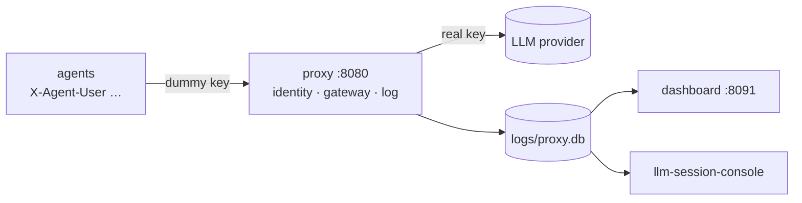

# llm-proxy-log

> An OpenAI-compatible LLM proxy that logs every exchange to SQLite, with a small dashboard and a recorded demo team.

**Animated explainer:** [explainers/index.html](explainers/index.html) · [published](https://claude.ai/artifact/B6okrEHnusms6PxDMCbbGY)

## What it is
Your AI agents keep calling the LLM exactly as before; you only change their base URL to this proxy.
The proxy holds the real API key, forwards every request, and writes one row per call to
`logs/proxy.db`: who asked (user, department, agent, session), what was sent, what came back, how
long it took, how many tokens it used. A small dashboard shows the result. Nothing else to install.

## 60-second quickstart (no API key)
```bash
git clone <this repo> && cd llm-proxy-log
python3 dashboard/server.py --demo        # http://127.0.0.1:8091 : a recorded week of a 4-person team
```
Python 3.10+, no packages needed for the proxy and dashboard.

Generate fresh traffic offline (a local fake LLM stands in for the provider):
```bash
pip install -r requirements.txt           # openai, only for the demo agents
python3 demo/run.py --offline
python3 dashboard/server.py               # reads logs/proxy.db
```

## Run it live
```bash
export OPENROUTER_API_KEY=sk-or-...       # or any OpenAI-compatible provider + UPSTREAM_BASE_URL
python3 proxy/proxy.py                    # http://127.0.0.1:8080/v1
```
Point your agent at it and say who is calling:
```python
from openai import OpenAI
client = OpenAI(base_url="http://127.0.0.1:8080/v1", api_key="dummy",
                default_headers={"X-Agent-User": "omar", "X-Agent-Dept": "support",
                                 "X-Agent-Id": "support-bot", "X-Session-Id": "ticket-311"})
```
Or run the demo team against the real provider: `python3 demo/run.py --live`.

## How it works

- The proxy strips the identity headers and the client key, adds the real key, forwards.
- The **gateway** waits for a rate-limit slot, retries 429/5xx, falls back to a cheap paid model when
  the free daily cap is used up, stops at a spend cap, and caches answers for replay.
- One row per call in `calls` (schema: [SPEC.md](SPEC.md), K-log-schema@1); secrets redacted.
- The dashboard opens the file read-only. So can any other tool: the schema is a versioned contract.
- Details: [ARCHITECTURE.md](ARCHITECTURE.md). Walkthrough: [demo/DEMO.md](demo/DEMO.md).

## Siblings
- **llm-proxy-firewall**: this repo plus a firewall that reads every conversation and can block it.
- **llm-session-console**: a drill-down console (users, days, sessions, messages, 3D view) over this log.
- **vxc-motors-sim**: a simulated BMW dealership whose 12 employees are agents talking through this proxy.

## Rebuild it
This repo is built with [Prax Systems](../prax-systems/METHOD.md): the code is one rendering of the
spec. [GOAL](GOAL.md) · [SPEC](SPEC.md) · [PROMPTS](PROMPTS.md) (start with P-REBUILD) ·
[ARCHITECTURE](ARCHITECTURE.md) · [ROADMAP](ROADMAP.md) · [DECISIONS](DECISIONS.md)

## Tests
```bash
python3 -m unittest discover -s tests     # offline: fake provider, real proxy and dashboard processes
python3 tools/prax_check.py . --level silver
```

License: Apache 2.0 (see LICENSE).
