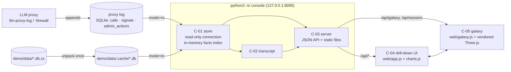

# Architecture · llm-session-console

## Component diagram

## Runtime
| Process | Command | Port / file | Env |
|---|---|---|---|
| console | `python3 -m console [--db PATH]…` | `127.0.0.1:8095`; reads the logs, writes only `demo/data/.cache/` | `CONSOLE_PORT`, `CONSOLE_SYSTEM_AGENTS` |
| live replay (demo only) | `python3 demo/live_replay.py --speed 20` | writes `demo/data/.cache/live.db` | — |
| sample builder (maintainers) | `python3 tools/make_samples.py DAY1.db DAY2.db` | writes `demo/data/*.db.xz` | — |

No third-party Python packages. The browser loads only files from `web/` (Three.js r170 is in
`web/vendor/`, MIT licence).

## How a request flows
1. On start, `Store` opens each log with `file:…?mode=ro` in autocommit mode, detects tables and
   columns, and copies the light columns of every call into an in-memory `facts` table (user, dept,
   session, day, hour, weekday, tokens, cost, firewall level, system flag) using the identity rules of
   SPEC §3.3. `signals` and `admin_actions` are copied into `sig` / `act` with the user resolved.
2. Each API request first checks the log's mtime (and its `-wal`); if it changed, only rows with
   `id > last_id` are added (live mode, R-016).
3. Aggregates (`overview`, `users`, `sessions`, `firewall`, `galaxy`) are SQL over `facts`, never over
   the big JSON columns. Only `session`, `call`, `search`, session titles and tool counts touch
   `request` / `response`.
4. `transcript.build_session` walks a session's calls in order. Because each request repeats the
   whole conversation, it diffs the request's messages against the previous request plus its answer
   and keeps only what is new.
5. The UI is a hash router (`#/u/<user>?from=…`). Filters live in the URL, so the breadcrumb and the
   browser's back button are the drill-up. A stale response (the user clicked on) is dropped.
6. The galaxy is loaded on demand (`import("./galaxy.js")`) and torn down when you leave it.

## Data model
The log schema is the owners' (`K-log-schema@1/@2`, SPEC §3). The console's own working tables live
only in memory:

| Table | Columns |
|---|---|
| `facts` | id, ts, day, hour, dow, user, dept, agent, session, status, ok, model, finish, duration_ms, prompt_tokens, completion_tokens, total_tokens, cost, fw, fw_rank, is_system, kind, tools |
| `sig` | signals + day, resolved user, is_system |
| `act` | admin_actions + day, resolved user, is_system |

## Requirement → code map
| R-id | Where |
|---|---|
| R-001 | `console/store.py: Store.__init__` (mode=ro, isolation_level=None) |
| R-002 | `console/store.py: Store.__init__, _c` (column detection), `has_signals` |
| R-003, R-004, R-017 | `console/store.py: Store.refresh` (COALESCE chains), `identity_source` |
| R-005 | `console/store.py: Filters.where, Store.overview` |
| R-006 | `console/store.py: Store.series, _bucket_expr` |
| R-007 | `console/store.py: Store.users` |
| R-008 | `console/store.py: Store.user, heatmap, tool_usage` |
| R-009 | `console/store.py: Store.sessions, _session_titles` |
| R-010, R-103 | `console/transcript.py: build_session, new_messages, parse_response` |
| R-011 | `console/store.py: Store.call` |
| R-012 | `console/store.py: Store.firewall`; `web/app.js: viewFirewall` |
| R-013, R-022 | `console/store.py: Store.galaxy`; `web/galaxy.js: mount` |
| R-014 | `console/store.py: Store.search`; `web/app.js: viewSearch` |
| R-015 | `console/store.py: SYSTEM_AGENTS, Filters.system` |
| R-016 | `console/server.py: Logs.get` → `Store.refresh` |
| R-018 | `console/server.py: unpack_samples, main` |
| R-019, R-020 | `console/server.py: make_handler.static, api` |
| R-021, R-023, R-024 | `web/app.js: viewGlobal, viewUser, viewSession, bucketClick, crumbs` |
| R-101 | `facts` index; aggregates never parse JSON |
| R-104 | `web/app.css` tokens + `prefers-color-scheme`; `web/galaxy.js` `reduced` |

## Extension points
- **New chart metric:** add a key to `series` in `store.py` and to `keysFor` in `app.js: seriesChart`.
- **New identity source:** extend the COALESCE chain in `Store.refresh` and SPEC §3.3.
- **New log table** (e.g. tool executions): detect it in `Store.__init__`, load it like `sig`, attach
  it in `transcript.build_session`.
- **Another 3D mapping:** `galaxy.js` only needs `/api/galaxy` and `/api/session/<id>`.
