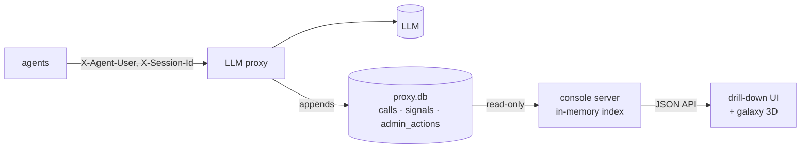

# llm-session-console

> A local web console that drills down from all traffic to one user, day, session, message and firewall event, with a 3D galaxy view.

**Animated explainer:** [explainers/index.html](explainers/index.html) · [published](https://claude.ai/artifact/PezDkCy9QLtZon76eJiGnT)

## What it is
Your LLM proxy (e.g. [llm-proxy-log](../llm-proxy-log/) or [llm-proxy-firewall](../llm-proxy-firewall/))
writes every agent conversation into a SQLite file. That file is complete but unreadable: each row
repeats the whole conversation, JSON inside JSON. This console opens it **read-only** and lets you go
from the big picture to a single message in a few clicks:

**all traffic → one user → one day or week → one session → one LLM call → the firewall finding on it.**

Per user and globally you get calls, sessions, tokens and active users by day or week, a weekday × hour
heatmap, the tools the LLM called, and — when the log comes from the firewall proxy — every info,
warning and block. A Three.js **galaxy** shows the same hierarchy in 3D: users are stars, sessions are
planets, calls are moons; click to drill.

## 60-second quickstart (no API key, no install)
```bash
git clone <url> llm-session-console && cd llm-session-console
python3 -m console              # Python 3.10+, standard library only
# open http://127.0.0.1:8095/
```
It serves four bundled logs (picker top right): four weeks of the VXC Motors dealership (12 employee
agents + customers, real recorded LLM traffic, firewall on), the first recorded VXC day in the old
log format, and the Brightleaf demo team's week from llm-proxy-log (no firewall) and from
llm-proxy-firewall (with firewall). See [demo/DEMO.md](demo/DEMO.md) for
a ten-step walkthrough.

## Use it on your own log
```bash
python3 -m console --db /path/to/proxy.db                 # any K-log-schema@1 or @2 log, or older ones
python3 -m console --db a.db --db b.db --port 8100        # several logs, switch in the UI
```
The proxy can keep writing: new calls show up on the next click. The console never writes to the
log. To identify users, have your agents send `X-Agent-User` (and optionally `X-Agent-Dept`,
`X-Session-Id`) to the proxy; without it the console falls back to the hashed API key, then the agent id.

## How it works

- Opens the log with SQLite `mode=ro` in autocommit, so the proxy is never blocked.
- Indexes the light columns of every call in memory (user, day, tokens, firewall level); charts never
  parse the big JSON.
- Rebuilds each session as a conversation: each call contributes only the messages it added.
- Shows the firewall layer only if the log has a `signals` table.
- Plain SVG charts, vendored Three.js, no CDN: works offline.
Details: [ARCHITECTURE.md](ARCHITECTURE.md).

## Rebuild it
This repo follows [Prax Systems](../prax-systems/METHOD.md): the code is one rendering of the spec.
[GOAL](GOAL.md) · [SPEC](SPEC.md) · [PROMPTS](PROMPTS.md) (start with P-REBUILD) ·
[ARCHITECTURE](ARCHITECTURE.md) · [ROADMAP](ROADMAP.md) · [DECISIONS](DECISIONS.md)

## Tests
```bash
python3 -m unittest discover -s tests -t .      # offline, ~2 s
python3 tools/prax_check.py . --level silver     # Prax Systems compliance
```

## Layout
```
console/      store.py (read-only log + aggregates) · transcript.py (sessions as conversations) · server.py
web/          index.html · app.js (drill-down) · charts.js (SVG) · galaxy.js (Three.js) · vendor/
demo/         data/*.db.xz (recorded logs) · DEMO.md · live_replay.py
tools/        make_samples.py (builds demo/data) · prax_check.py
explainers/   index.html (animated, self-contained)
tests/        fixtures.py (logs in every schema) · test_store.py · test_server.py
```

Licence: Apache 2.0. Three.js: MIT (web/vendor/THREE-LICENSE).
