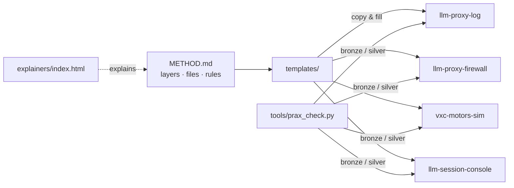

# Architecture · Prax Systems

## Runtime
| Process | Command |
|---|---|
| checker | `python3 tools/prax_check.py <repo> [--level silver] [--json]` |
| tests | `python3 -m unittest discover -s tests` |

## Requirement → code map
| R-id | Where |
|---|---|
| R-001, R-004, R-011 | `tools/prax_check.py:check` (bronze block) |
| R-002 | `tools/prax_check.py:spec_requirements` |
| R-003 | `tools/prax_check.py:check` (PROMPTS block) |
| R-005, R-006 | `tools/prax_check.py:check` (silver block) |
| R-010 | `templates/` |

## Extension points
Add a level (e.g. Gold automation) in `check()`; add a template in `templates/` and a line in METHOD.md §3.
