# Prax Systems

> Ship code with the specs and prompts to rebuild it.

<p align="center"></p>

## The problem it solves

Code written today by today's model is out of date within months. The intent behind it, the
contracts between its parts and the reasons for each choice usually live only in chat history and in
the head of whoever built it, so they are lost. That hurts most for *systems* (agents, proxies,
services, consoles), where the behaviour that matters happens between the parts and much of it comes
from a non-deterministic LLM. Nobody can safely rewrite such a system, in a new language or with a
better model, because nobody can say exactly what it was supposed to do or prove that the rewrite
still does it.

Prax Systems fixes that by making the specification the thing you keep: every repo ships its goal,
numbered requirements, versioned contracts, decisions and the ordered prompts that rebuild it, plus
tests and recorded demo data that prove any rebuild is right.

## What it is

Prax Systems is the third member of the Prax family. *Prax Analytics* builds data pipelines
(sources → transforms → tests → reports). *Prax App* builds single applications (screens → state →
API). **Prax Systems** builds *systems*: several cooperating parts (services, agents, data stores,
consoles, external providers) held together by contracts, where the interesting behaviour lives
*between* the parts.

Its one hard rule:

> **Code is one rendering of the system. The specification is the system.**
> Every repository ships the code **and** the goal, the specification, the architecture, the
> decisions, and the ordered prompts that let a future model rebuild it, in the same language or a
> different one, and prove the rebuild is right with the same tests and demo data.

## Why a new method

| | Prax Analytics | Prax App | **Prax Systems** |
|---|---|---|---|
| Unit of work | a pipeline | an app | a **system** of parts with contracts |
| Shape | linear: source → model → report | one UI over one backend | a graph: agents, proxies, services, stores, consoles |
| Main risk | wrong numbers | bad UX | parts disagree about a contract; behaviour emerges between parts |
| Proof | data tests | UI tests | **contract tests + recorded demo traffic + replay** |
| What must survive a rewrite | SQL + data contracts | screens + API | **goal, spec, contracts, rebuild prompts, golden demo data** |

## The repository contract (what every Prax Systems repo contains)

```
<repo>/
  prax.yaml          manifest: name, goal, components, how to run demo and tests, build provenance
  README.md          the front door: what, why, 60-second quickstart, links
  GOAL.md            why it exists, who it is for, the problem, success criteria, non-goals
  SPEC.md            the source of truth: components, contracts, behaviours as numbered requirements (R-xxx)
  ARCHITECTURE.md    how the parts fit: diagram, data flow, runtime, where each requirement lives in code
  PROMPTS.md         the ordered rebuild prompts (P-01…), each citing the requirements it delivers
  ROADMAP.md         milestones (M1…) with status, and what comes next
  DECISIONS.md       decision log (D-001…): context, choice, alternatives, consequences
  demo/              recorded demo data + a script that generates live traffic + DEMO.md walkthrough
  explainers/        index.html: self-contained animated explainer (what, goal, problem, how, replicate)
  tests/             acceptance tests, each tagged with the R-ids it proves
  tools/prax_check.py  vendored Prax checker (copied from prax-systems)
  src/ (or similar)  the code: one rendering of the spec
```

The full method is in [METHOD.md](METHOD.md). Templates for every file are in
[templates/](templates/). The checker [tools/prax_check.py](tools/prax_check.py) tells you whether a
repo complies (`python3 tools/prax_check.py ../llm-proxy-log`).

## This repo follows itself

| File | |
|---|---|
| [GOAL.md](GOAL.md) | why Prax Systems exists |
| [SPEC.md](SPEC.md) | the method as numbered requirements (R-xxx) |
| [METHOD.md](METHOD.md) | the method explained: phases, artifacts, rules, worked example |
| [PROMPTS.md](PROMPTS.md) | prompts that rebuild this methodology repo |
| [ROADMAP.md](ROADMAP.md) | where the method is going |
| [DECISIONS.md](DECISIONS.md) | why it looks like this |
| [explainers/index.html](explainers/index.html) · [published](https://claude.ai/artifact/UTh6wAi3B7iQc4dyAj7MPP) | the animated explainer |
| [examples/](examples/) | the four systems built with it |

## Systems built with Prax Systems

| Repo | What it is |
|---|---|
| `llm-proxy-log` | An OpenAI-compatible proxy that logs every LLM exchange to SQLite, with a small dashboard and demo team |
| `llm-proxy-firewall` | `llm-proxy-log` plus a session firewall (info / warning / block, proxy answers as the LLM on block) |
| `vxc-motors-sim` | A simulated BMW dealership: 12 employees are agents, enterprise apps are tools backed by real local services |
| `llm-session-console` | A drill-down console (global → user → day → session → message → firewall event) and a 3D galaxy view over the proxy log |

## License

MIT, see the root of each published repo.
