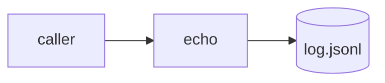

# Architecture · echo-log

| R-id | Where |
|---|---|
| R-001 | `src/echo.py:echo` |
| R-002 | `src/echo.py:echo` |
| R-003 | `src/echo.py:replay` |

Runtime: one process, `python3 src/echo.py`. Data model: see K-echo-log@1 in SPEC.md.
