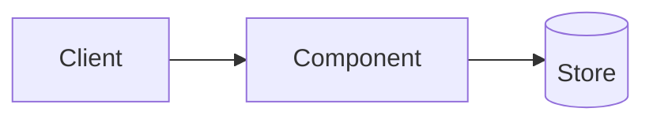

# Architecture · <name>

## Component diagram

## Runtime
| Process | Command | Port / file | Env |
|---|---|---|---|

## Data model
Tables / files with columns. Link to the contract in SPEC.md rather than duplicating it.

## Requirement → code map
| R-id | Where |
|---|---|
| R-001 | `src/…:function` |

## Extension points
Where a reader adds a new rule, tool, agent, chart…
