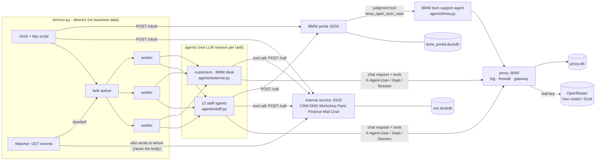
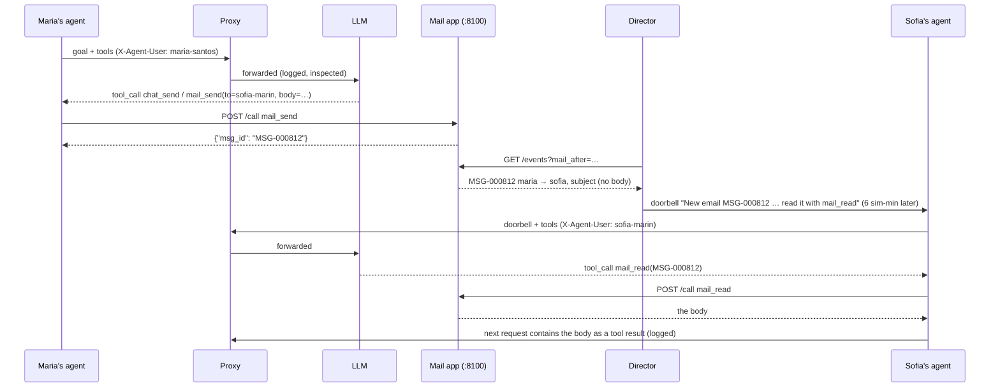

# Architecture · vxc-motors-sim

## Component diagram

## One email, end to end

## Runtime
| Process | Command | Port / file | Env |
|---|---|---|---|
| Director | `python -m sim.run` | `logs/workday/runner.jsonl` (or `VXC_RUN_DIR`) | `VXC_RUN_DIR`, `GATEWAY_*`, `LLM_MODEL` |
| Application services | started by the director: `python -m apps.server` | :8100 internal, :8200 portal; `data/*.duckdb` (`VXC_DATA_DIR`) | `VXC_INTERNAL_URL`, `VXC_PORTAL_URL`, `VXC_BMW_AGENT` |
| Proxy | started by the director: `proxy/proxy.py` | :8080, `proxy.db`, `gateway.db` | `OPENROUTER_API_KEY`, `UPSTREAM_BASE_URL`, `PROXY_PORT`, `FIREWALL_*`, `GATEWAY_*` |
| Agents | threads of the director (and the BMW tech agent inside the portal service) | `agents/<user>.jsonl` | `LLM_BASE_URL` (default `http://127.0.0.1:8080/v1`), `LLM_MODEL` |
| Fake LLM (offline) | `python -m sim.fake_llm --port 9099` | — | — |

DuckDB allows one writing process per file, so both services run in one process with one
connection per database, serialised by a lock. The judgment tool's LLM call runs *before* that lock
is taken (`Tool.prepare`), so a slow model never blocks the portal.

## Data model
- Internal (`apps/schema.py: INTERNAL`): staff, customers, customer_vehicles, leads, test_drives,
  activities, vehicles, deals, approvals, order_requests, invoices, bookings, job_cards, job_lines,
  time_entries, parts, parts_movements, parts_requests, ledger, **messages**, **chat_messages**, audit_log.
- Portal (`apps/schema.py: PORTAL`): dealers, portal_users, models, car_orders, parts_catalog,
  parts_orders, parts_order_lines, warranty_claims, recalls, recall_vins, bulletins, **tech_cases**,
  portal_access_log.
- Seed: `apps/seed.py` (history 2026-01-01 → 2026-10-27 07:45) + `apps/scenario_today.py` (the open
  work each person finds that morning). Snapshots in `data/parquet/`.
- Run output: K-vxc-run@1 (SPEC §3).

## Requirement → code map
| R-id | Where |
|---|---|
| R-001 | `sim/run.py:main` |
| R-002 | `llm/client.py:make_client`, `agents/staff.py:StaffAgent.run`, `agents/external.py` |
| R-003, R-007 | `agents/external.py:MailAgent`, `sim/run.py:external_party`, `run_reply` |
| R-004, R-014 | `apps/mail.py:mail_send` |
| R-005, R-015 | `sim/run.py:Watcher.on_mail`, `apps/server.py:events` |
| R-006, R-013 | `apps/chat.py`, `sim/run.py:Watcher.on_chat` |
| R-008, R-027 | `sim/day.py:EVENTS`, `proxy/firewall_topics.yaml`, `sim/evaluate.py` |
| R-009 | `sim/export.py --demo`, `demo/data/`, `viz/workday.html` |
| R-010–R-012, R-016 | `apps/server.py:make_handler`, `tools_for`, `apps/common.py:profile` |
| R-017, R-021 | `apps/bmw_portal/__init__.py:bmw_open_tech_case`, `agents/bmw.py` |
| R-018 | `apps/common.py:call`, `_audit` |
| R-019 | `apps/dms.py:dms_link_bmw_order` |
| R-020 | `sim/run.py` (HTTP only) |
| R-022 | `sim/export.py:redact`, `copy_db`, `snapshot` |
| R-023 | `apps/catalogue.py` |
| R-024 | `apps/rules.py`, `apps/dms.py`, `apps/workshop.py`, `apps/parts.py`, `apps/crm.py` |
| R-025 | `apps/seed.py` |
| R-026 | `sim/day.py`, `sim/run.py --plan` |

## Extension points
- **New tool:** a function with `@tool("<app>", "...", param=Param(...))` in `apps/<app>.py`; rerun
  `python -m apps.catalogue`. Give the app to a persona by adding it to `systems:` in the persona file.
- **New judgment tool:** pass `prepare=` to `@tool`: the prepare step calls an agent (see
  `agents/bmw.py`) before the database lock, the tool stores and returns its answer.
- **New employee:** a persona file in `company/personas/`; the seed and prompts pick it up.
- **New outside party:** an address domain in `sim/run.py:external_party` with its system prompt in
  `agents/prompts.py`.
- **New scenario or incident:** an event in `sim/day.py:EVENTS` (with `expect` for incidents) and,
  if the firewall should know it, a topic in `proxy/firewall_topics.yaml`.
- **Another proxy:** set `LLM_BASE_URL` to any OpenAI-compatible endpoint that accepts
  K-agent-headers@1; the director only uses the bundled proxy if nothing answers there.
