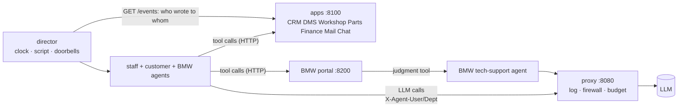

# vxc-motors-sim

> A simulated BMW dealership whose 12 employees are LLM agents and whose enterprise apps are tools
> backed by small real local services. Every word anyone says goes through one logging, firewalled
> LLM proxy.

**Animated explainer:** [explainers/index.html](explainers/index.html) · published: https://claude.ai/artifact/8wC8ce5VHxeCewFyGd2izD

## What it is
VXC Motors sells and services BMWs in Reading. Its twelve people (a GM, reception, finance, a sales
manager and two consultants, an aftersales manager, two service advisors, two technicians, a parts
coordinator) are **agents**: each one is an LLM conversation that can act only by asking the LLM for
a **tool call**. The tools are the dealership's **applications** (CRM, dealer management, workshop,
parts, finance, email, team chat, and BMW's partner portal), each a small HTTP service over DuckDB.
Customers and BMW are agents too. Email and chat land in real mailboxes; the recipient's agent is
told "you have mail" and reads it with a tool call. Every LLM call carries who is speaking
(`X-Agent-User`, `X-Agent-Dept`), so a proxy and a console can see the whole company at work —
including six staged incidents (a hidden discount, a customer list for a friend, a shared password…).

It exists to produce **realistic, repeatable multi-agent traffic** for the sibling repos
([llm-proxy-log](../llm-proxy-log), [llm-proxy-firewall](../llm-proxy-firewall),
[llm-session-console](../llm-session-console)) and to show plainly how agents reach systems.

## 60-second quickstart (no API key)
```bash
git clone <url> vxc-motors-sim && cd vxc-motors-sim
pip install -r requirements.txt
python3 demo/run_demo.py          # the recorded live day in demo/data -> http://127.0.0.1:8765/viz/workday.html
```

Or run the **whole day offline** against a scripted fake LLM (real proxy, real services, ~1 minute):
```bash
python3 -m sim.fake_llm --port 9099 &
UPSTREAM_BASE_URL=http://127.0.0.1:9099/api/v1 OPENROUTER_API_KEY=sk-fake FIREWALL_INTENT=off \
GATEWAY_FREE_RPM=1000 python3 -m sim.run
```

## Run it live
```bash
export OPENROUTER_API_KEY=...                         # only the proxy ever sees it
python3 -m sim.run --plan                             # the day's script, no LLM calls
GATEWAY_FREE_RPM=8 python3 -m sim.run --max-calls 500 # ~1 hour at 8 requests/min on the free model
python3 -m sim.export --demo                          # snapshot into demo/data (keys scrubbed) + viz/workday.html
python3 -m sim.evaluate demo/data                     # firewall precision/recall against the script's ground truth
```
If the free model is not answering, add `LLM_MODEL=z-ai/glm-5.3-flash` (a cheap paid model; a whole
day costs cents; `GATEWAY_SPEND_CAP_USD` caps it, default 4).

One agent on its own: `python3 -m apps.server &` then
`python3 -m agents.run_one tom-becker "Check your inbox and deal with what is waiting."`

## How it works

- **Agents** (`agents/`): 12 staff, customers, BMW desks. They only ever do two things: talk to the LLM, and run the tool calls it asks for.
- **Tools** (`apps/`, catalogue in [TOOLS.md](TOOLS.md)): 74 tools in 8 applications, deterministic code over DuckDB, rules enforced there (discount limits, approvals, parts against job cards). One **judgment tool**, `bmw_open_tech_case`, is answered by another agent.
- **Mail and chat** are applications. `mail_send` / `chat_send` store; the director rings the recipient's doorbell (never with the text); the recipient reads with `mail_read` / `chat_unread`. So every message is in the proxy log twice: as the sender's tool call and as the reader's tool result.
- **The director** (`sim/run.py`) owns the simulated clock and the day script (`sim/day.py`), and never touches business data.
- **The proxy** (`proxy/`, a copy of llm-proxy-firewall) logs every call to `proxy.db`, runs the firewall and the budget gateway, and holds the only key.

Details: [ARCHITECTURE.md](ARCHITECTURE.md). What is behind every tool: [TOOLS.md](TOOLS.md).

## Rebuild it
This repo is built with [Prax Systems](../prax-systems/METHOD.md): the code is one rendering of the spec.
[GOAL](GOAL.md) · [SPEC](SPEC.md) · [TOOLS](TOOLS.md) · [PROMPTS](PROMPTS.md) (start with P-REBUILD) ·
[ARCHITECTURE](ARCHITECTURE.md) · [ROADMAP](ROADMAP.md) · [DECISIONS](DECISIONS.md) · [demo walkthrough](demo/DEMO.md)

## Tests
```bash
python3 -m unittest discover -s tests          # offline: fake LLM, temp databases (about a minute)
python3 tools/prax_check.py . --level silver   # Prax Systems compliance
```

## Layout
| Folder | What |
|---|---|
| `company/` | personas (`personas/<id>.md`), avatars, org chart, business rules |
| `apps/` | the applications: tools, rules, seed, HTTP services, catalogue |
| `agents/` | staff, outside and BMW agents, prompts, the HTTP tool client |
| `sim/` | director, day script, export, evaluation, fake LLM |
| `llm/` | LLM client with identity headers, agent-side log |
| `proxy/` | vendored logging + firewall + gateway proxy, VXC topic file |
| `demo/` | the recorded day (`data/`) and the walkthrough |
| `viz/` | the day timeline page, 3D dealership, data-model page |
| `explainers/` | the animated explainer |
| [`people/`](people/README.md) | each employee's resume, job, persona and soul (intrinsic context, added to every staff prompt) |
| [`offsite/`](offsite/README.md) | the all-staff off-site held in a chat: recorded run and replay |

License: MIT (see LICENSE). All people, companies and data are fictional.
